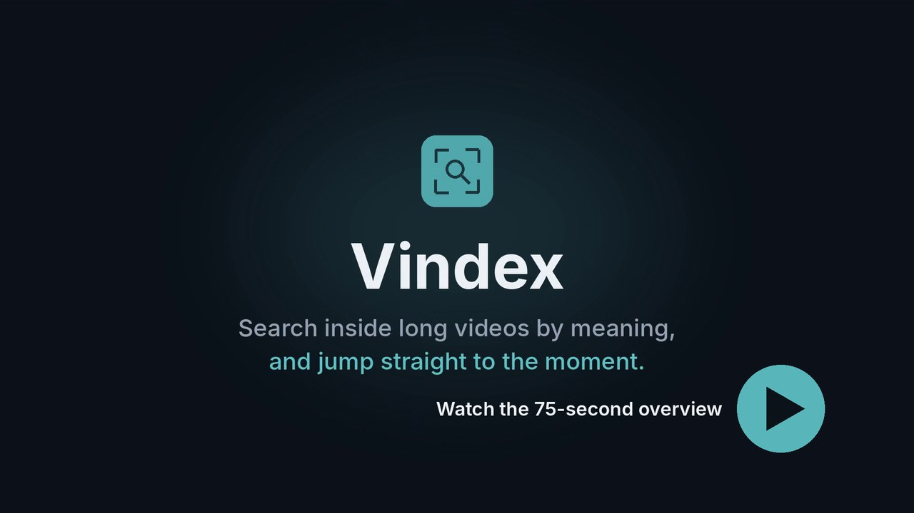
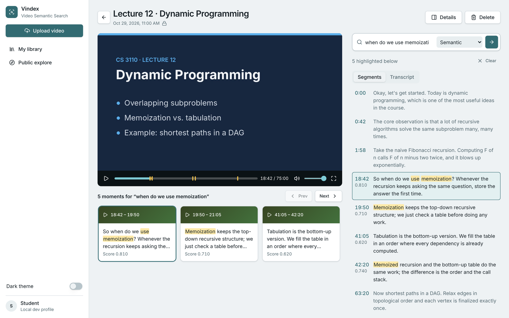
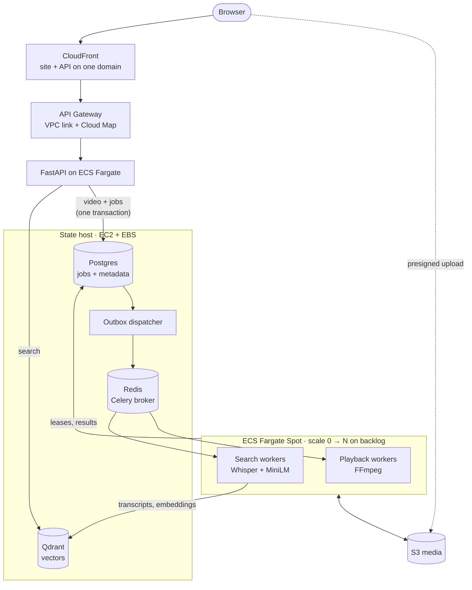
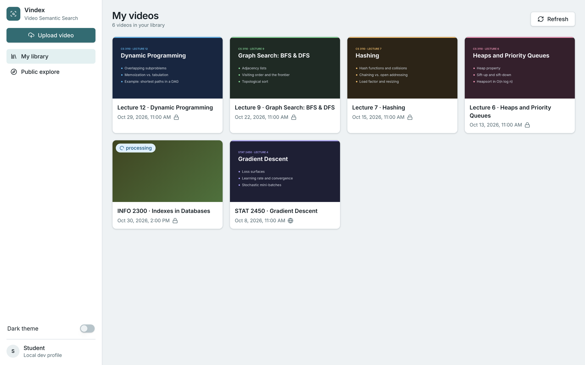

# Vindex

**Search inside long videos by meaning, and jump straight to the moment.**

[](https://github.com/DavidQifongJiang/Vindex/actions/workflows/ci.yml)
[](https://github.com/DavidQifongJiang/Vindex/actions/workflows/deploy.yml)

A student searches a two-hour lecture for *"when do we use memoization?"*. Vindex finds the minute where the professor explained it, even if they said "store the answer the first time" and never used the word. Upload a video and Vindex transcribes it, embeds every passage, and serves timestamped semantic search. It runs on AWS, scaling its processing workers from zero when work arrives and back to zero when it's done.

**Live demo:** [d3tj3ho29p8iwn.cloudfront.net](https://d3tj3ho29p8iwn.cloudfront.net/). Sign in to upload. The demo may be switched off between sessions to save cost.

<a href="docs/media/vindex-explainer.mp4"></a>

*[▶ Watch the 75-second overview](docs/media/vindex-explainer.mp4) · the problem, a search demo, the pipeline, the AWS architecture and measured results.*

<picture>
  <source media="(prefers-color-scheme: dark)" srcset="docs/images/search-dark.png">
  
</picture>

## Highlights

| | |
|---|---|
| **82% faster to searchable** | Redesigned a monolithic worker into a chunked Celery DAG: 226.7 s → 40.7 s for a 19-minute video ([benchmark](#pipeline-speed)). |
| **90% Hit@5 on real lectures** | 100 hand-labelled queries over 10 MIT algorithms lectures; P95 search latency 72 ms ([benchmark](#search-quality)). |
| **Scale to zero** | Workers run on Fargate Spot and scale 0 → N on pipeline backlog, then back to 0. Idle cost ≈ $5/month when switched off. |
| **Safe under crashes and redelivery** | Postgres-owned job state, fenced leases, idempotent uploads and attempt-scoped artifacts keep results correct when workers crash, Spot tasks are reclaimed or messages are delivered twice. |
| **Infrastructure as code + keyless CD** | About 90 AWS resources in Terraform. Every merge to `main` is tested, then deployed by GitHub Actions through OIDC, with no stored AWS keys. |

## How it works



Cognito handles sign-in, and CloudWatch receives the backlog metric that drives worker autoscaling.

**The life of a video**

1. **Upload, directly to S3.** The API issues a presigned POST locked to one key, content type and exact size; the browser uploads the file without it touching the API (API Gateway caps requests at 10 MB). On completion the API snapshots the object to a server-only key, so a reused upload URL can't change what gets processed.
2. **Enqueue durably.** The video row and its pipeline jobs are written in one Postgres transaction (an outbox). A dispatcher publishes due work to Redis and republishes anything unclaimed, so a lost message delays work but never drops it.
3. **Process as a DAG.** Two independent branches run:
   - **Playback:** FFmpeg transcodes the video and makes a thumbnail.
   - **Search:** the audio is split into 5-minute chunks; each chunk is transcribed (Whisper), embedded (MiniLM) and written to Qdrant in parallel, and a finalize step publishes the video as searchable once every chunk has finished.
4. **Scale on backlog.** Every minute the state host publishes the number of pending and in-flight items per queue. Autoscaling starts a worker within a minute of work arriving, adds workers as backlog grows, and returns to zero after five idle minutes. Scale-in only happens at zero backlog, so a worker is never stopped mid-chunk.
5. **Search.** The query is embedded and matched against that video's passages in Qdrant; results come back as timestamped moments that seek the player.

## Engineering decisions

| Decision | Why |
|---|---|
| **Postgres owns job state; Redis only carries messages** | Workers claim work with fenced leases (token + expiry), so a redelivered or zombie task can't overwrite a newer attempt. Crashed work is recovered by lease expiry instead of being lost in Redis. |
| **Scale on a Postgres backlog metric, not Redis queue length** | The dispatcher republishes unclaimed work, so Redis length overcounts. Counting pending + processing items in Postgres also keeps scale-in from killing in-flight tasks. |
| **Browser → S3 uploads, then a server-side snapshot** | Removes API Gateway's 10 MB / 30 s limits and keeps large files off the API. The snapshot closes a race where a still-valid presigned URL could replace the input mid-processing. |
| **API Gateway + VPC link instead of an ALB; no NAT Gateway** | Together these save ~$55/month for a low-traffic demo. CloudFront fronts both the site and the API on one domain, so there's no CORS between them. |
| **Fargate Spot workers** | About 70% cheaper; interruptions are just lease expiries the pipeline already retries. |
| **One small state host instead of RDS/Aurora** | The dispatcher polls Postgres every 5 s, so Aurora Serverless could never pause. Postgres, Redis and Qdrant share a `t3.small` with an encrypted data volume, daily snapshots and auto-recovery. |
| **Models baked into the image** | A worker scaled up from zero starts without downloading Whisper or MiniLM. |

The full failure and recovery design is mapped in [`docs/diagrams/reliability-map`](docs/diagrams/reliability-map/README.md) and [`docs/operations/reliability_and_recovery.md`](docs/operations/reliability_and_recovery.md).

## Benchmarks

### Pipeline speed

`test_video.mp4`: 19.3 minutes, 4 search chunks.

| Setup | Time-to-searchable | |
| --- | ---: | --- |
| Original monolithic worker, EC2 `t3.medium` | 226.74 s | baseline |
| Chunked DAG, `t3.medium`, 1 search worker | 172.97 s | 23.7% faster |
| Chunked DAG, `t3.medium`, 2 search workers | 216.41 s | slower: CPU contention on 2 vCPUs |
| Chunked DAG, `c7i.2xlarge`, 1 search worker | 101.79 s | bigger CPU, no parallelism |
| Chunked DAG, `c7i.2xlarge`, 2 search workers | 58.84 s | two chunks at once |
| Chunked DAG, `c7i.2xlarge`, 4 search workers | **40.73 s** | **82.0% faster than baseline** |

The `t3.medium` result is why workers now run as separate Fargate tasks: parallel chunks only help when each worker has its own CPU. Details: [`backend/benchmarks/pipeline_stats_summary.md`](backend/benchmarks/pipeline_stats_summary.md).

### Search quality

10 MIT 6.006 lecture videos (first 15 minutes each), 100 manually curated queries. The lectures share one domain and many overlapping topics, which makes this harder than a single-video demo.

| Metric | Result |
| --- | ---: |
| Hit@1 | 65.0% |
| Hit@5 | 90.0% |
| MRR | 0.746 |
| Precision@5 | 43.4% |
| Median / P95 timestamp error | 16.1 s / 62.3 s |
| P95 API search latency | 71.7 ms |

Top-5 retrieval is reliable; ranking within the top 5 and timestamp precision are the clearest areas to improve. Details: [`backend/benchmarks/expanded_15min_search_quality_report.md`](backend/benchmarks/expanded_15min_search_quality_report.md).

<details>
<summary><b>Library view</b></summary>
<br>
<picture>
  <source media="(prefers-color-scheme: dark)" srcset="docs/images/library-dark.png">
  
</picture>
</details>

## Tech stack

| Layer | Tools |
|---|---|
| Frontend | React, TypeScript, Vite, Tailwind, shadcn/ui |
| API | FastAPI, Pydantic, SQLAlchemy, Alembic |
| Processing | Celery, FFmpeg, OpenAI Whisper (`tiny`), sentence-transformers (`all-MiniLM-L6-v2`) |
| Data | Postgres, Redis, Qdrant, S3 |
| AWS | CloudFront, API Gateway, ECS Fargate (+ Spot), EC2, Cloud Map, Cognito, CloudWatch, SSM |
| Delivery | Terraform, GitHub Actions (CI + OIDC deploys), Docker |
| Quality | 340+ backend tests (SQLite + Postgres), Playwright browser suites, Codex PR review |

## Repository layout

```text
backend/     FastAPI app, Celery workers, Alembic migrations, tests, benchmarks
frontend/    React + TypeScript app
infra/       Terraform, deploy and demo on/off scripts, AWS bootstrap
docs/        Architecture, reliability map, search experiments, operations
ops/         CI helpers, monitoring and backup configuration
.github/     CI and Deploy workflows
```

## Running locally

Needs Docker, plus an S3 bucket and AWS credentials for media storage.

```bash
cp .env.example .env            # set S3_BUCKET_NAME and AWS_REGION; auth is off by default
docker compose up --build -d
curl http://localhost:8000/health
```

Open <http://localhost:8000>. Uploads go through the API in local mode, so no bucket CORS is needed.

Tests:

```bash
cd backend && python -m unittest discover -s tests     # set VINDEX_TEST_DATABASE_URL to include Postgres tests
cd frontend && npm ci && npm run build
```

See [`AGENTS.md`](AGENTS.md) for the full command list and conventions.

## Deploying

Merging to `main` runs CI, then the Deploy workflow: `terraform apply`, image build and push, migrations and pipeline processes on the state host, ECS rollout, then the frontend upload. A deploy takes about 10 minutes.

```bash
infra/scripts/demo.sh off   # stop everything except storage (~$5/month)
infra/scripts/demo.sh on    # bring the demo back (~2 minutes)
```

Setup, costs and operations: [`infra/README.md`](infra/README.md).

<details>
<summary><b>API reference</b></summary>

| Endpoint | Purpose |
| --- | --- |
| `GET /health` | Service health |
| `GET /me` | Current user |
| `GET /videos` | Your videos |
| `GET /public/videos` | Public feed |
| `POST /videos/uploads` | Start a direct-to-S3 upload (presigned POST) |
| `POST /videos/uploads/{id}/complete` | Verify the upload and queue processing |
| `POST /videos/upload` | Multipart upload through the API (local development) |
| `GET /videos/{id}/status` | Processing status |
| `GET /videos/{id}/segments` | Timestamped transcript segments |
| `GET /videos/{id}/transcripts` | Full transcript |
| `POST /videos/{id}/search` | Search inside a video |
| `GET /videos/{id}/file-url` | Temporary playback URL |
| `GET /videos/{id}/thumbnail-url` | Temporary thumbnail URL |
| `GET /videos/{id}/metrics` | Per-video performance metrics (owner only) |
| `DELETE /videos/{id}` | Delete the video and every artifact (owner only) |

Responses use explicit Pydantic models: storage keys, processing tokens and owner IDs never leave the API.
</details>

## Roadmap

- Measure time-to-searchable for a two-hour lecture on the deployed stack, and record the 0 → N → 0 scaling run.
- Course-level search across every lecture in a class, plus keyword + semantic hybrid search (implemented, needs Elasticsearch in the deployment).
- Larger Whisper models for technical vocabulary.
- Multipart uploads for files over 5 GB, and a custom domain.
