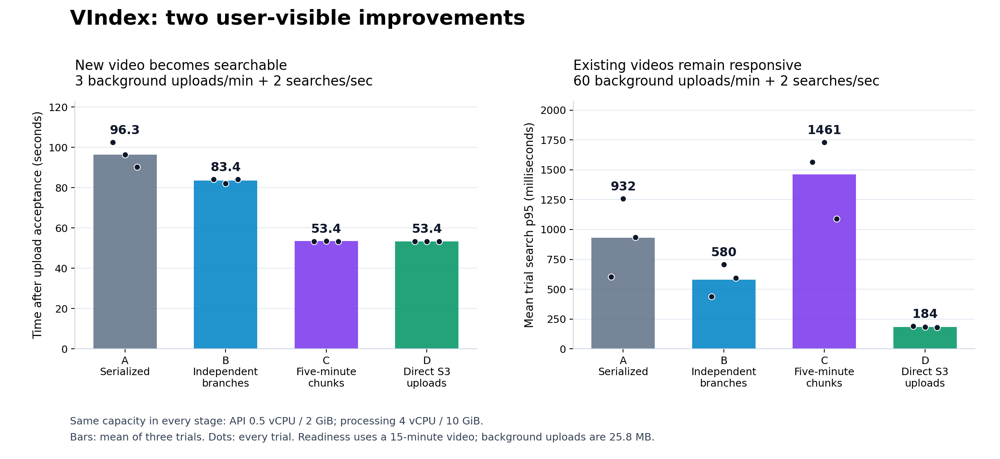

# VIndex: aligned A/B/C/D architecture comparison

Completed 2026-11-12 UTC (2026-11-11 Eastern). [PR #24](https://github.com/DavidQifongJiang/Vindex/pull/24). Application services were not redeployed for this experiment.

This experiment measures two different user experiences in every configuration: how soon a new video becomes searchable, and how quickly searches of existing videos respond while uploads and processing run. Readiness is in **seconds**; query latency is in **milliseconds**.



## What changed

| Stage | Upload path | Processing |
|---|---|---|
| A | API → S3 | Retained whole-video processor: playback preparation, transcription, embedding and indexing in sequence |
| B | API → S3 | Independent playback and search branches; whole-video search work unit |
| C | API → S3 | Same DAG, with three five-minute search chunks for the 15-minute input |
| D | Browser → S3 | Same chunked processing as C; API authorizes and finalizes the upload |

Every stage uses the same 0.5-vCPU / 2-GiB API and 4-vCPU / 10-GiB processing pool. All four worker processes are warmed before every trial. A has the same available processing parallelism across videos; the sequence within each video is serialized.

## New-video readiness

| Stage | 3 uploads/min: three observations (s) | Mean (s) | 60 uploads/min: three observations (s) | Mean (s) |
|---|---|---:|---|---:|
| A | 102.5, 96.3, 90.2 | 96.3 | 215.0, 190.9, 209.4 | 205.1 |
| B | 84.1, 82.1, 84.1 | 83.4 | timeout, timeout, timeout | Censored |
| C | 53.4, 53.5, 53.4 | 53.4 | 227.7, timeout, 225.9 | Censored |
| D | 53.4, 53.4, 53.4 | 53.4 | timeout, 221.5, 217.4 | Censored |

Each observation starts at successful browser upload acceptance and ends at the first correct semantic response for the 15-minute video. Polling occurs every two seconds. Failed or timed-out observations remain visible; the report does not replace them with later server processing timestamps. Only three independent long videos per cell were measured, so this is not a readiness p95 or a population SLA.

The low-load readiness gains do not establish the same benefit at 60 uploads/minute: that workload builds processing backlog and includes censored readiness observations. Existing-video query responsiveness is a separate outcome, measured below.

| Incremental change | Metric and workload | Observed comparison |
|---|---|---|
| A → B: independent branches | Readiness at 3 background uploads/min | 13.4% lower; 95% paired bootstrap reduction interval 6.8% to 17.9% |
| B → C: chunking | Readiness at 3 background uploads/min | 36.0% lower; 95% paired bootstrap reduction interval 34.8% to 36.5% |
| C → D: direct S3 | Existing-video search p95 at 60 uploads/min | 87.4% lower; 95% paired bootstrap reduction interval 83.4% to 89.4% |
| A → D: cumulative | Readiness at 3 background uploads/min | 44.6% lower; 95% paired bootstrap reduction interval 40.8% to 47.9% |

Percentage reductions use `(before − after) / before × 100`. Cumulative reductions are calculated directly; incremental percentages are not added. Every other observed stage pair, at both rates and for both metrics, is included in the summary JSON.

Direct-upload readiness must be assessed separately from query responsiveness. The C → D low-load readiness result is 0.06% lower; 95% paired bootstrap reduction interval -0.04% to 0.20%. An interval spanning zero reduction does not establish a readiness improvement.

## Existing-video searches and resource use

| Rate/min | Stage | Mean trial search p95 (ms) | No-upload p95 (ms) | API CPU (% allocation) | Worker CPU (% allocation) | Upload acceptance p95 (s) |
|---:|---|---:|---:|---:|---:|---:|
| 3 | A | 180.3 | 171.0 | 22.0 | 44.0 | 11.30 |
| 3 | B | 181.6 | 183.3 | 21.1 | 43.9 | 11.30 |
| 3 | C | 178.0 | 164.7 | 20.1 | 49.9 | 11.31 |
| 3 | D | 189.0 | 168.9 | 14.4 | 48.6 | 11.97 |
| 60 | A | 932.2 | 170.7 | 99.2 | 94.3 | 12.77 |
| 60 | B | 579.8 | 168.4 | 99.3 | 96.4 | 12.08 |
| 60 | C | 1461.2 | 169.1 | 99.2 | 95.4 | 14.74 |
| 60 | D | 184.1 | 164.0 | 39.4 | 94.0 | 12.25 |

Search values are means of three per-trial p95 values, not percentiles obtained by pooling requests. CPU values are sampled load-window means relative to each container’s fixed quota. Lower API CPU is evidence of headroom; the query latency comparison demonstrates the user-facing effect. This experiment does not prove reduced cloud bills, prevented production outages, or a higher sustainable processing capacity.

## Acceptance gates and backlog

| Rate/min | Stage | Arrival/resource validity | Integrity | Upload acceptance gate | Search SLO | Pending growth per trial |
|---:|---|---|---|---|---|---|
| 3 | A | 3/3 | 3/3 | 3/3 | 3/3 | 1, 1, 1 |
| 3 | B | 3/3 | 3/3 | 3/3 | 3/3 | 1, 1, 1 |
| 3 | C | 3/3 | 3/3 | 3/3 | 3/3 | 1, 1, 1 |
| 3 | D | 3/3 | 3/3 | 3/3 | 2/3 | 1, 1, 1 |
| 60 | A | 3/3 | 3/3 | 3/3 | 0/3 | 77, 78, 78 |
| 60 | B | 3/3 | 3/3 | 3/3 | 0/3 | 107, 106, 106 |
| 60 | C | 3/3 | 3/3 | 3/3 | 0/3 | 105, 106, 106 |
| 60 | D | 3/3 | 3/3 | 3/3 | 3/3 | 105, 105, 105 |

Primary accounting: **1536/1536 accepted uploads**, including 24 long-video attempts; **12960/12960 correct scheduled existing-video queries** across baseline, load and recovery. Complete per-attempt ledgers are preserved.

The search SLO requires load p95 ≤1 second and ≤1.20× that trial’s no-upload baseline, with ≥99% correctness. Admission requires ≥99% success. Validity also requires complete unique ledgers, no client pool exhaustion, p99 start lag ≤100 ms, client sampled CPU/memory below 90%, no API/infrastructure restart or OOM, unchanged quotas, and a continuously verified warm worker pool. A failed search SLO remains a measured outcome; it is not dropped to improve averages.

Pending growth compares the first and last server samples within the load window. A positive value is a finite-window backlog warning, not a sustainable-capacity estimate. Before teardown, unfinished work and the database snapshot are preserved; explicitly retiring that work for cleanup is never counted as a processing success.

## Bottleneck evidence

The three low-load serialized long-video profiles averaged 95.4 seconds of processing, including 72.9 seconds of Whisper transcription (76.5% of the processing duration). These server profiles identify the bottleneck; they do not replace browser-observed readiness. Independent branches remove playback from the search dependency chain; chunking divides transcription work across the unchanged pool.

## Resume wording supported by this experiment

- Re-architected serialized video processing into a Celery DAG with independent playback and search branches, reducing time to searchability by 13% (96.3 → 83.4 seconds) for 15-minute test videos on unchanged compute.
- Split whole-video search processing into parallel five-minute chunks for transcription, embedding and indexing, cutting time to searchability a further 36% (83.4 → 53.4 seconds) on the same processing capacity.
- Diagnosed API CPU contention (99% utilization) during concurrent ingestion and replaced API-proxied uploads with direct-to-S3 uploads, reducing p95 existing-video search latency 87% (1461 → 184 ms) at 60 uploads/minute without increasing API resources.

The processing comparisons use 3 background uploads/minute; the direct-upload comparison uses 60. Both include two existing-video searches/second. These are controlled benchmark results, not measurements of customer traffic. The workload, three repetitions, synthetic fixture, and growing high-load processing backlog remain part of the evidence behind the wording.

## Method, calibration and limits

- 24 primary trials: A → B → C → D repeated three times at 3 and 60 background uploads/minute. Rate order alternates between repetitions; fixed stage order can retain temporal confounding.
- Each trial: 30 seconds without uploads, 120 seconds of offered upload traffic, then 120 seconds of recovery. One 900-second synthetic speech video starts with the load; background files contain 20 seconds of speech and are 25,808,821 bytes. The long fixture repeats synthetic speech and does not establish performance across natural lectures.
- Uploads use real frontend flows in Chromium, 24 prepared contexts with one reserved for the long video; each has 20-Mbps upload shaping and 40-ms latency. A separate client process sends two semantic queries per second against three protected processed videos. Authentication uses an isolated benchmark session; Cognito login and public Internet latency are outside the measurement.
- A reconstructs the retained serialized implementation in the same pinned image; it is not a historical deployment. A → B includes existing extraction/publication implementation differences. B → C changes the search work-unit duration while retaining the same durable DAG and publication rules. C → D changes the upload route.
- Every stage uses the same Whisper tiny and MiniLM model configuration and a pinned application image. All four worker children are warmed, then PID/start-time sets and container images/quotas are checked through every primary trial. Source and frontend hashes are checked before and after collection.
- Nine calibration trials are retained and excluded from primary estimates. Pilot 001 used 60-second load windows; high-load readiness timeouts helped establish the need for a longer observation interval. Its high-rate direct trial exceeded the 90% client CPU gate and is invalid for a comparative claim. Its old negative-probe bounds and less strict process/artifact checks are not used for primary claims. Pilot 002 checks the full 120-second high-rate direct workload after assigning 3.5 vCPU to uploads and 0.25 vCPU to queries on the same client host; application quotas and validity gates remain unchanged.
- Paired uncertainty resamples whole matched trials 10,000 times with seed 20261112. Three independent pairs cannot establish a population SLO. If an interval crosses no change, the evidence does not establish a directional improvement for that comparison.
- The original primary attempt stopped during its first trial because exact timestamp identity checking rejected normal JSON/Qdrant floating-point roundoff. All seven retained inputs had matching counts and text; the maximum timestamp difference was 5.68e-14 seconds. The corrected check permits only 1 ns absolute roundoff and preserves exact text/cardinality. The failed attempt, diagnosis, and post-fix verification are retained separately; all 24 trials were rerun under a new registration. Between-trial dispatcher shutdown was shortened while processing workers retained their drain allowance; timed windows were unchanged.
- The earlier upload-only and readiness experiments remain separate supporting evidence. Their observations are not pooled. The existing 100-query search-quality evaluation is also separate; expected-answer checks here do not re-estimate Hit@5 or MRR.

## Evidence and reproduction

- [Registered complete-run plan](evidence/aligned_architecture_2026-11-12/primary-002-plan.json), [protocol](aligned_architecture_protocol.md), [primary summary](evidence/aligned_architecture_2026-11-12/primary-summary.json), [initial calibration](evidence/aligned_architecture_2026-11-12/pilot-summary.json), [client headroom calibration](evidence/aligned_architecture_2026-11-12/pilot-002-summary.json), [aborted original primary attempt](evidence/aligned_architecture_2026-11-12/aborted-primary-summary.json).
- [Public raw evidence](evidence/aligned_architecture_2026-11-12/raw-evidence.zip), [file manifest](evidence/aligned_architecture_2026-11-12/raw-manifest.json), [offline reproduction](evidence/aligned_architecture_2026-11-12/reproduction.json). Private SQL, credentials and raw application logs are retained locally and excluded from this archive.

From the repository root with Python 3.11:

```powershell
python -m zipfile -e docs/architecture/evidence/aligned_architecture_2026-11-12/raw-evidence.zip .review-cache/aligned-reproduce
python backend/benchmarks/analyze_architecture_experiment.py .review-cache/aligned-reproduce/aligned-primary-002 --registered .review-cache/aligned-reproduce/registration/primary-plan.json --output .review-cache/aligned-reproduce/primary-summary.json
```

Use registered plan bytes from the archive for SHA verification; Git newline conversion may change file bytes without changing JSON content. The plotting script requires Matplotlib; PNG and SVG outputs are standalone.

## Cleanup

All experiment-owned instances, volumes, bucket, security group, role and instance profile were removed after evidence preservation. Estimated EC2 compute through the stop request: **$2.67**, below the $5 estimate ceiling. This is not a bill and excludes disk, IPv4, storage/request and shutdown charges. [Cleanup verification](evidence/aligned_architecture_2026-11-12/cleanup-verification.json) records resource absence and unchanged shared service capacity.
