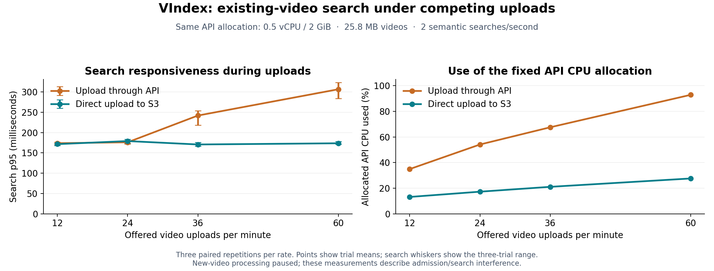

# Direct-to-S3 uploads: search responsiveness at fixed API capacity

Completed controlled experiment, 2026-11-11. [PR #23](https://github.com/DavidQifongJiang/Vindex/pull/23) is stacked on [PR #22](https://github.com/DavidQifongJiang/Vindex/pull/22). No application deployment was needed for this comparison.

At **60 offered uploads/minute and 2 semantic searches/second**, direct S3 reduced the mean trial search p95 from **307 ms to 174 ms (43.4% lower)** with the same **0.5 vCPU / 2 GiB API**. API CPU utilization fell from 92.8% to 27.6% of that allocation (70.3% lower).

The demonstrated product benefit is lower search latency while other users upload videos. This is a controlled comparison of the two upload routes in the same application, not evidence that the previous production app had outages.



## Before and after

- API route: browser sends the file through the API; the API fingerprints it, writes it to S3, and durably records the video and initial processing jobs.
- Direct route: API authorizes/reserves the upload, the browser sends bytes directly to S3, and the API verifies a private snapshot before durably recording the video and jobs.
- The video-processing implementation, API allocation, fixtures, search corpus, request rate and client conditions stay fixed. Both paths retain the existing durable job and publication rules.

## Primary results: processing paused

| Offered uploads/min | API search p95 | Direct search p95 | Direct vs API | API / direct search-gate passes |
|---:|---:|---:|---:|---:|
| 12 | 174 ms | 172 ms | 1.3% lower | 3/3 / 3/3 |
| 24 | 176 ms | 179 ms | 1.7% higher | 3/3 / 3/3 |
| 36 | 242 ms | 171 ms | 29.4% lower | 1/3 / 3/3 |
| 60 | 307 ms | 174 ms | 43.4% lower | 0/3 / 3/3 |

Each value is the arithmetic mean of three per-trial p95 values, not a p95 computed by pooling all requests. Plot whiskers show the three-trial range. Every repetition, including failed latency gates, remains in the report and raw evidence.

At 12 and 24 uploads/minute, the paired intervals include no difference; this test does not establish a search-latency improvement at those lighter loads. Every primary load p95 remained below one second. Search-gate failures came from the predefined 20% relative-degradation limit.

At 60 uploads/minute, the API route's matched no-upload baseline averaged 168 ms, compared with 307 ms under upload load. The direct route averaged 178 ms without uploads and 174 ms with uploads. This distinguishes upload-induced interference from a general change in search speed.

The registered search target was p95 <=1 second **and** <=1.20 times the matched no-upload baseline. The highest tested rate passing **all** admission/search/integrity gates in every repetition was **24/minute through the API and 60/minute through direct S3**. These are tested rates on a fixed grid, not estimates of either route's maximum capacity. Both routes could accept the highest offered traffic; the differentiator was search interference under the relative-latency target.

At 60/minute, the paired 10,000-resample bootstrap interval for the search-p95 reduction is 39.8%–45.1%. Resampling preserves whole trial pairs (seed 20261111). There are only **three independent pairs per rate**; this interval is conditional on this experiment and does not establish a population SLA.

| Other primary measurements at 60 uploads/min | API route | Direct S3 |
|---|---:|---:|
| Mean allocated API CPU utilization | 92.8% | 27.6% |
| Mean trial upload-acceptance p95 | 11.22 s | 11.98 s |
| Accepted / scheduled uploads at this rate | 540/540 | 540/540 |

Across all primary rates, **2,376/2,376 uploads** were accepted and byte/hash verified, and **12,959/12,960 scheduled queries** returned the expected result. Those query totals include baseline, load and recovery. All 24 primary trials passed client timing/headroom, infrastructure stability and integrity validation. There was no pool exhaustion, and API resources stayed fixed.

The direct route did not improve individual upload acceptance time in this workload: its mean trial upload p95 at 60/minute was 0.76 seconds higher. The complete browser path includes hashing, upload reservation and completion; the API route has fewer browser round trips. This comparison did not isolate the cost of each step.

One search request returned HTTP 502 during recovery in `primary-r03-u024-direct`; the proxy recorded a connection reset by its API upstream. No API restart or OOM was observed. The specific cause of that reset remains unproven. The failure is retained in the totals: 12,959/12,960 correct overall, including 8,640/8,640 during load. See the [failure investigation](evidence/mixed_upload_search_2026-11-11/failure-investigation.json). This result does not demonstrate zero errors.

The resource evidence supports API quota contention as the mechanism: at 60/minute, the API CPU throttled-time counter increased by a mean 104.37 seconds during the sampled load windows on the API route, versus 0.033 seconds on direct S3. Proxy CPU averaged 22.1% of its allocation on the API route and mean Postgres CPU was below 4.2% on either route. Across all primary trials, sampled client CPU peaked below 49.4% of its quota, memory below 19.4%, and query-phase p99 start lag below 1.25 ms. These checks provide no indication that the client generator caused the measured search difference; the throttled-time counter is not a request-latency measurement.

Direct uploads also require client checksum work, reservation/completion requests, a private S3 snapshot copy and cleanup of abandoned objects. The implementation preserves integrity through those steps, but this experiment does not establish lower total cloud cost.

## Worker-active confirmation

A separate plan selected 3 and 36 uploads/minute before primary outcomes. Each route ran once per rate with a 60-second baseline, 300-second load and 60-second recovery. Search workers had 2 vCPU / 4 GiB; playback had 1 vCPU / 2 GiB; each used one worker process. Containers restart per trial and include lazy model startup. This is exploratory confirmation, not another three-pair estimate.

| Uploads/min | Route | Search p95 | Search gate | Searchable completions/min | Playback status completions/min | Pending near load end | Pending near recovery end |
|---:|---|---:|---|---:|---:|---:|---:|
| 3 | api | 179 ms | pass | 2.94 | 2.94 | 1 | 0 |
| 3 | direct | 169 ms | pass | 2.94 | 2.94 | 1 | 0 |
| 36 | direct | 179 ms | pass | 18.39 | 7.31 | 137 | 138 |
| 36 | api | 264 ms | fail | 18.57 | 7.30 | 137 | 139 |

All four confirmation trials passed arrival, integrity and worker-capacity/stability checks, with 390/390 accepted uploads, 3,360/3,360 correct queries and no failed processing jobs before teardown. At 3/minute, both routes completed all 15 videos by the final recovery observation. At 36/minute, existing-video search p95 was 264 ms through the API versus 179 ms through direct S3, while processing completion rates stayed similar.

**The full-pipeline sustainability gate failed at 36/minute for both routes.** Each accumulated 137 pending videos near the end of load; the backlog grew by 66 during the last half of load on each route, and oldest-pending age rose from about 117 to 227 seconds. At the final recovery observations, 139 API-route videos and 138 direct-route videos were still pending. Playback completion was approximately 7.3/minute and search publication approximately 18.4–18.6/minute in the sampled load windows. These outcomes support better isolation of existing-video search from uploads, not a claim of 36 fully processed videos/minute.

Completion rates use the actual elapsed time between the first and last samples inside the load window. Pending counts use the last sample within each window, not an extrapolation to the exact boundary. The JSON report includes offsets, every backlog observation, oldest-pending age and last-half load growth. A video remains pending until both search and playback statuses are complete.

Search publications marked complete receive vector-lineage/cardinality and semantic-response checks after timing. Playback completion here means the database reports a processed video with a processed path; this measurement does not decode each output. Post-timing verification can observe additional completed work, so those counts are not substituted for timed throughput. Unfinished test jobs are archived and retired during teardown, never counted as completed work.

## Workload, validity and limits

- The measured application is commit `a458bc2e5b19335025eed8ec63599e2c02297330`, pinned by image digest. The same deployed code supports both paths. This is not a comparison of a serialized pipeline against a parallel DAG.
- Each synthetic video is 25,808,821 bytes and 20 seconds long. Three protected, already-processed videos and four fixed queries exercise per-video semantic search, not library-wide search or a large production corpus.
- The real React upload form runs in Chromium with 24 prepared contexts, each capped at 20 Mbps upload / 100 Mbps download with 40 ms latency. A separate Node process offers two queries per second over identical, unshaped private query-network conditions. The client is a separate EC2 host; searches do not share an uploading tab.
- Absolute scheduled arrivals preserve failures and late work in denominators. Client validity requires complete unique ledgers, no pool exhaustion, p99 start lag <=100 ms, no OOM, and sampled CPU-quota/memory peaks below 90%. Server container identities, starts, OOM state and API quota are checked. Resource sampling cannot rule out every sub-sample burst.
- Private benchmark authentication is used on the isolated service. Cognito login overhead and end-user Internet latency are not measured. Search response validation is an expected-answer check on synthetic speech, not a broad relevance evaluation.
- Three paired repetitions use rotated rate order and alternating route order. Each primary trial has 60 seconds baseline, 180 seconds load and 30 seconds recovery. Primary sample counts and gates were locked before collection. Eight calibration trials (396 uploads, 2,880 queries) are retained and excluded from the primary estimate.
- Lower API CPU use explains more headroom. Actual billing savings, fewer crashes, faster time-to-searchable and a larger sustainable processing capacity require separate evidence. Short finite trials and a growing worker backlog cannot establish long-running end-to-end capacity.

## Evidence and reproduction

- [Registered primary plan](evidence/mixed_upload_search_2026-11-11/primary-plan.json), [registered worker-active plan](evidence/mixed_upload_search_2026-11-11/integrated-plan.json), and [protocol](mixed_upload_search_protocol.md).
- [Primary summary and every trial](evidence/mixed_upload_search_2026-11-11/primary-summary.json), [worker-active summary and backlog series](evidence/mixed_upload_search_2026-11-11/processing-summary.json).
- [Complete public measurement evidence](evidence/mixed_upload_search_2026-11-11/raw-evidence.zip) and [file-level manifest](evidence/mixed_upload_search_2026-11-11/raw-manifest.json). Credentials, private SQL snapshots and raw application logs are excluded from the public archive and retained locally. All selected public files are checked against the preserved source archive.
- Public archive SHA-256: `02aecf1381696f736210f043da19335bc981849fee4ef29abc0588dde77b169f`.

From the repository root, using Python 3.11, extract the public evidence and reproduce both reports:

```powershell
python -m zipfile -e docs/architecture/evidence/mixed_upload_search_2026-11-11/raw-evidence.zip .review-cache/mixed-reproduce
python backend/benchmarks/summarize_mixed_comparison.py .review-cache/mixed-reproduce/primary-001 --registered .review-cache/mixed-reproduce/registration/primary-plan.json --output .review-cache/mixed-reproduce/primary-summary.json
python backend/benchmarks/summarize_mixed_processing.py .review-cache/mixed-reproduce/integrated-001 --registered .review-cache/mixed-reproduce/registration/integrated-plan.json --output .review-cache/mixed-reproduce/processing-summary.json
```

Use the original registered bytes bundled inside the archive for the plan SHA; Git text newline conversion can otherwise change a file hash without changing its JSON contents. The numeric reports were reproduced from this public archive and compared as complete JSON objects; see the [reproduction receipt](evidence/mixed_upload_search_2026-11-11/reproduction.json). The plotting helper uses Matplotlib; the published PNG and SVG are standalone artifacts.

## Cleanup and validation

All owned experiment instances, attached volumes, bucket, security group, IAM role and instance profile were removed after final evidence preservation. Estimated EC2 compute through the stop request: **$3.19**, within the original $5 estimated round ceiling. This is not an AWS bill and excludes small disk, IPv4, S3 request/storage and shutdown charges.

[Cleanup and shared-service checks](evidence/mixed_upload_search_2026-11-11/cleanup-verification.json) record the observed final state. The original shared application capacity was not changed by this experiment. Protected seed lineage remained unchanged and twelve final semantic checks ran outside all measured intervals before seed teardown.

The comparison and processing-analysis regression tests, browser measurement tests, evidence reproduction and PR checks are recorded in the [execution notes](mixed_upload_search_execution.md).
