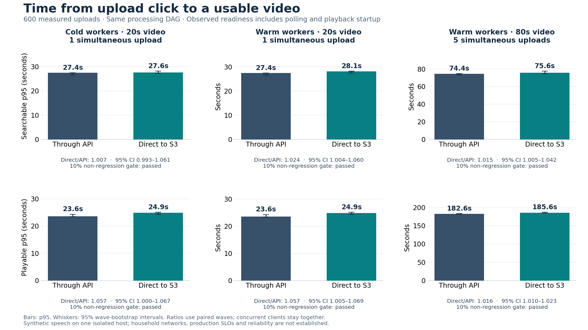

# Direct S3 upload: end-to-end comparison

Completed November 11, 2026 (UTC). **600 measured uploads and six excluded warm-ups
completed byte, semantic-search, decoded-playback, and durable-publication checks.**
All six preregistered search/playback p95 non-regression checks passed. Videos requiring a repeated processing attempt: **0**.

Direct upload's search p95 was **0.7–2.4% higher**, and playback p95 was
**1.6–5.7% higher**. The largest upper confidence bound was a 6.9% increase,
within the agreed 10% margin. Passing this margin does not mean identical speed
or a speedup. Observed API-container CPU totals were **68.4–71.8% lower** across
the matched cohorts; those totals include readiness polling and are described below.

The experiment compares the existing API upload route with direct S3 upload through
the **same processing DAG**, using application commit
`a458bc2e5b19335025eed8ec63599e2c02297330`. It does not compare an old serialized
pipeline with the new DAG. No application behavior or shared service capacity was
changed by this experiment.

## Measured latency

One client clock starts at the upload click. Accepted means the API returned a
video ID; searchable means a real semantic query found the annotated speech at
the expected time; playable means the browser decoded and advanced a video frame.
These are observed readiness times, including polling, request overhead, and
playback startup. Each cohort has 100 uploads per mode.

| Cohort | Milestone | API p50 / p95 | Direct p50 / p95 | Direct/API p95 (paired 95% CI) |
| --- | --- | ---: | ---: | --- |
| Cold, 20s, 1 client | Accepted | 11.55s / 11.68s | 12.26s / 12.47s | 1.068 [1.058, 1.079] |
| Cold, 20s, 1 client | Searchable | 24.42s / 27.42s | 26.00s / 27.62s | 1.007 [0.993, 1.061] |
| Cold, 20s, 1 client | Playable | 21.47s / 23.56s | 22.34s / 24.90s | 1.057 [1.000, 1.067] |
| Warm, 20s, 1 client | Accepted | 11.54s / 11.72s | 12.23s / 12.56s | 1.072 [1.046, 1.080] |
| Warm, 20s, 1 client | Searchable | 25.25s / 27.39s | 25.92s / 28.06s | 1.024 [1.004, 1.060] |
| Warm, 20s, 1 client | Playable | 21.72s / 23.57s | 22.32s / 24.90s | 1.057 [1.005, 1.069] |
| Warm, 80s, 5 clients | Accepted | 47.49s / 49.44s | 49.00s / 49.45s | 1.000 [0.997, 1.028] |
| Warm, 80s, 5 clients | Searchable | 71.07s / 74.44s | 73.43s / 75.57s | 1.015 [1.005, 1.042] |
| Warm, 80s, 5 clients | Playable | 129.30s / 182.60s | 131.28s / 185.60s | 1.016 [1.010, 1.023] |

A ratio below 1 favors direct upload. The p95 is the nearest-rank 95th percentile,
not the worst request. Intervals use 10,000 paired-wave bootstrap resamples, seed
20261110; the five concurrent clients stay clustered in their wave. The concurrent
cohort has only 20 independent wave pairs, despite 100 observations per mode.
These are per-comparison intervals, not a simultaneous family-wide guarantee.

## Acceptance gates

| Cohort | Search p95 upper bound ≤1.10 | Playback p95 upper bound ≤1.10 | Integrity / per-wave cleanup | Observed readiness ≥99% |
| --- | --- | --- | --- | --- |
| Cold, 20s, 1 client | passed | passed | passed | passed |
| Warm, 20s, 1 client | passed | passed | passed | passed |
| Warm, 80s, 5 clients | passed | passed | passed | passed |

The non-regression criterion is the **upper** confidence bound ≤1.10, not just the
point estimate. `Inconclusive` means the interval crosses 1.10; `failed` means
even its lower bound exceeds 1.10. An inconclusive result does not establish the
required limit or prove a regression greater than 10%.
Observed full readiness was 100% in each mode/cohort, and every accepted raw input
matched its expected byte count and SHA256. Reservation, durable job/chunk,
current vector-publication token, and vector-cardinality checks passed.

**Unverified:** absolute product SLO, population reliability, real user networks,
scale-from-zero latency, outage recovery, and optional library-wide indexing.
The 600-second attempt timeout was a safety deadline, not a product SLO. Repeated
synthetic inputs and correlated concurrent clients do not establish a population
99% reliability target.

## Where the time and work went

| Cohort | Search after acceptance: API / direct p95 | Playback after acceptance: API / direct p95 |
| --- | ---: | ---: |
| Cold, 20s, 1 client | 15.87s / 15.10s | 11.96s / 12.76s |
| Warm, 20s, 1 client | 15.88s / 15.87s | 11.91s / 12.76s |
| Warm, 80s, 5 clients | 26.39s / 26.41s | 134.32s / 135.40s |

These post-acceptance values are computed per upload and then summarized. They
are not the difference between two separately computed p95 values. Direct upload
removes bulk video transfer from the API, but workers still transcode, transcribe,
embed, and publish the same input. Independent search and playback branches can
finish at different times.

| Cohort | API-container CPU: API route / direct route |
| --- | ---: |
| Cold, 20s, 1 client | 84.52s / 26.71s |
| Warm, 20s, 1 client | 83.47s / 26.33s |
| Warm, 80s, 5 clients | 267.97s / 75.50s |

CPU values are totals across the 100 measured uploads in each mode/cohort. They
include API requests made during readiness polling and browser setup; they are
**not upload-only CPU measurements**, elapsed times, or a production cost forecast.
The runtime audit also records the other containers' CPU deltas.

The earlier [600-upload acceptance-only comparison](upload_comparison_results_2026-11-10.md)
measured a different workload, with processing paused, different video files, and
a separately provisioned client. Its API CPU and upload-acceptance results remain
separate. Cross-campaign differences cannot be attributed to the upload route;
the defensible comparisons here are the matched API/direct pairs within each row.

## Controls and limitations

- Preregistered 100 cold pairs, 100 warm short-video pairs, and 20 warm five-client
  pairs. API/direct order alternated; a seeded 0–5 second jitter preceded each
  measured wave. The locked plan was not changed after collection began.
- Exact inputs: 25,808,821 bytes / 20 seconds, and 103,231,087 bytes / 80.139 seconds,
  H.264/AAC with synthetic English speech. Both modes used identical input bytes.
  Each browser used a 20 Mbps upload / 100 Mbps download / 40 ms CDP profile.
- One isolated 8-vCPU/32-GiB host. API: 0.5 CPU/2 GiB; search: 2 CPU/4 GiB;
  playback: 1 CPU/2 GiB; browser: 2 CPU/4 GiB. One process per worker pool.
  Postgres, Redis, Qdrant, dispatcher, and proxy had separately enforced limits.
- Cold means both worker processes restarted with model files cached. Warm means
  an excluded fixture first completed both branches, with those processes retained.
  The API query model stayed warm throughout. Runtime identities, restarts, limits,
  empty queues, input hashes, route choices, and common clock origins were audited.
- Whisper tiny and all-MiniLM-L6-v2 were baked into the pinned application image.
  Authentication used a private synthetic identity; Cognito and public edge routing
  were outside the timed path. All services and the browser shared one test host.
- Both inputs are shorter than the default 300-second search chunk, so each uses
  one chunk. This does not measure multi-chunk parallel speedup or the historical
  serial-to-parallel re-architecture.
- Pilot 001 failed before upload because of an isolated proxy redirect; its failed
  evidence remains preserved. Pilot 002 had four measured uploads and one warm-up;
  pilot 003 had ten measured uploads. No pilot is pooled into primary results.

Collection ran from `2026-11-10T23:29:43.989442+00:00` to `2026-11-11T07:32:09.522864+00:00`
(8.04 hours), under the locked nine-hour campaign limit.
See the [execution record](pipeline_experiment_execution.md) and
[measurement contract](pipeline_readiness_protocol.md).

## Preservation and cleanup

The final archive contains the complete primary campaign and a stopped-worker
snapshot; all 7,469 retained files were downloaded and verified against their
SHA256 manifest. Public evidence contains selected synthetic
JSON/JSONL measurements and the exact measured harness; private logs, database
dumps, session state, and generated credentials remain outside version control.
Per-wave object counts covered the raw prefix; a separate final inventory covered
the **whole bucket**, and residual objects were preserved locally before deletion.

All dedicated experiment resources were removed: EC2 instance, attached volume,
bucket, security group, IAM role, and instance profile. Shared state remains
running; API and edge health checks passed. The receipt records observed shared
service counts without changing them.

Compute through the stop request was approximately **$3.44**
at $0.4032/hour. Shutdown time, disk, public IPv4, storage, requests, and transfer
are additional; this is an estimate, not an AWS bill. The preregistered round
ceiling was $5. See the [cleanup receipt](evidence/pipeline_comparison_2026-11-11/cleanup-verification.json).

## Reproduce and next gates

The [evidence directory](evidence/pipeline_comparison_2026-11-11/README.md) contains
raw measurements, per-entry hashes, the locked plan/measured harness, analysis,
runtime audit, fixture metadata, and commands to reproduce the result tables.
An offline reproduction verified all 6,796 public raw entries and matched every
analysis field except its generation timestamp, plus the complete runtime audit.
Full retained warm-worker logs showed one pool-worker identity per worker and no
Celery error/critical records or lost-worker errors. See the reproduction and log-audit
receipts in the evidence directory.
The [Vindex diagrams](vindex_architecture_diagrams.md) show the corresponding
upload path, scheduler, and processing DAG.

This completes the preregistered end-to-end comparison phase. The separate
450-MiB/ten-client/slow-network matrix, recovery cases, strict checksum rollout,
and any further DAG optimization remain future gates with their own bounded
plans and reviewed PRs. No new deployment or feature rollout is implied by these
results.
