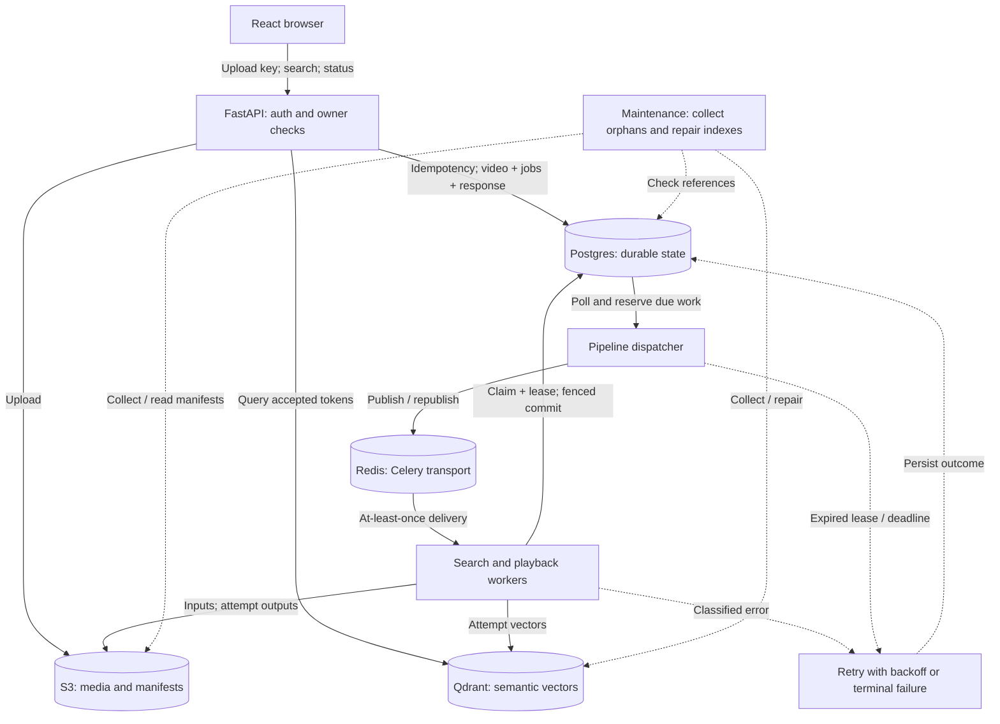
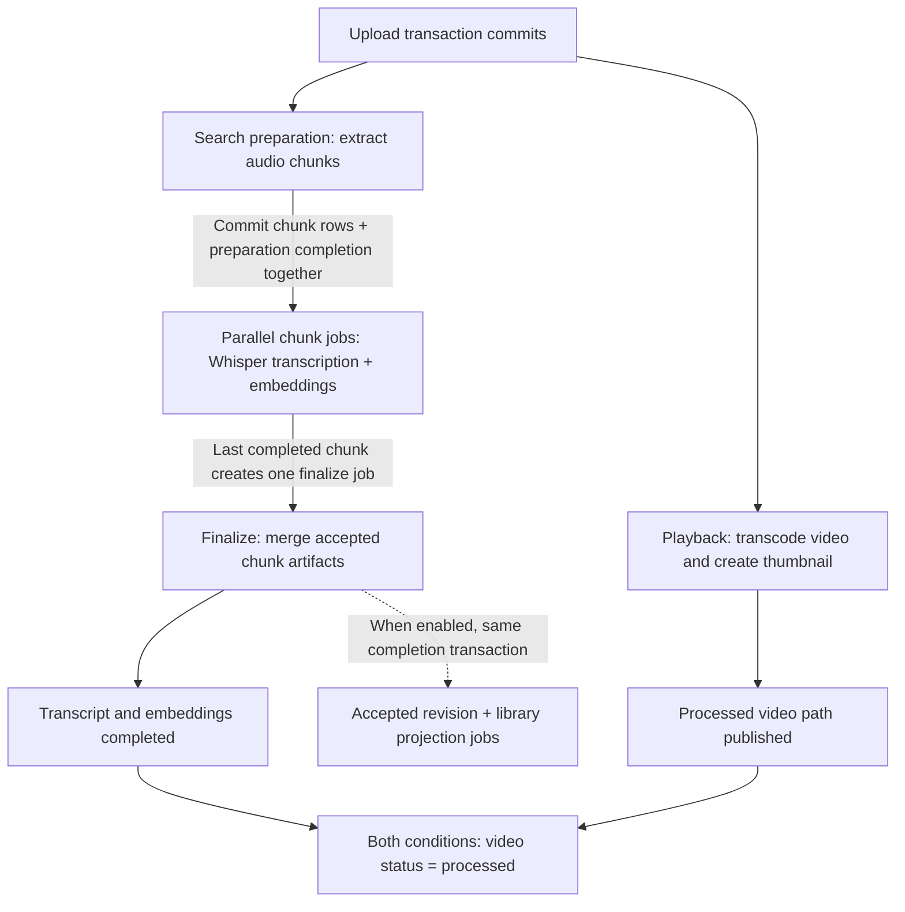
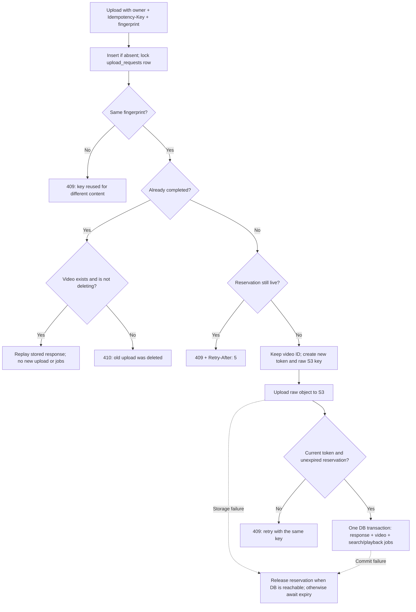
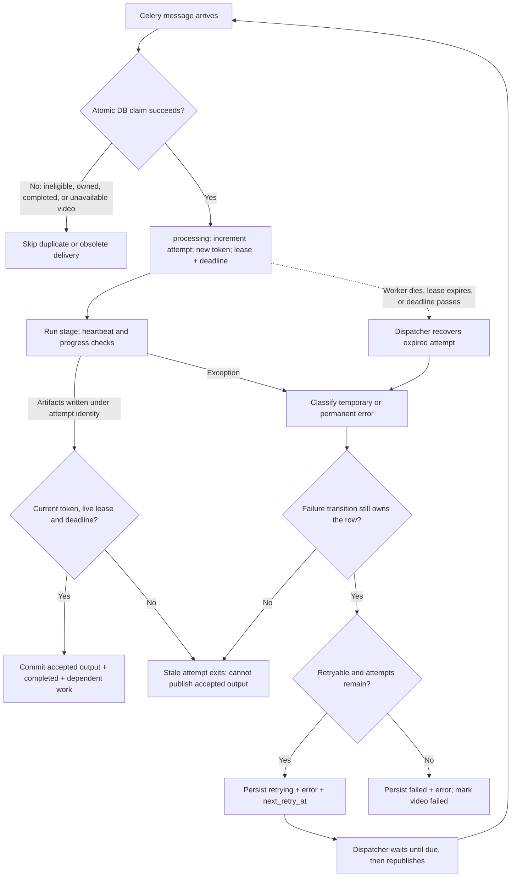
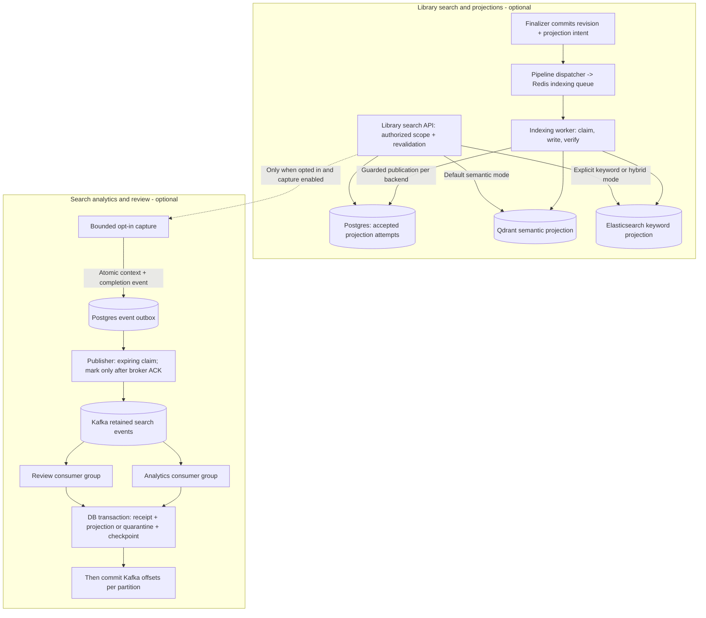

# Vindex system design

Vindex turns uploaded videos into playable media and searchable transcript segments.
Postgres owns durable work and the accepted results. Redis delivers Celery commands;
S3 holds media and manifests; Qdrant serves semantic retrieval. Optional library
projections add Elasticsearch keyword search and separate semantic indexes. Optional
Kafka consumers build search analytics and review views.

The reliability model is **at-least-once delivery with idempotent claims and guarded
publication**. Computation and external writes can repeat. Only a current attempt
can publish accepted output in Postgres; abandoned output is collected later.

These diagrams describe the current working-tree implementation as of October 25,
2026. Feature flags and deployment configuration determine which optional paths run.

Open the scalable diagrams: [overview](diagrams/system-overview.svg),
[processing stages](diagrams/processing-stages.svg),
[upload idempotency](diagrams/upload-idempotency.svg),
[retries and failures](diagrams/retries-and-failures.svg), and
[optional search and analytics](diagrams/optional-search-and-analytics.svg).
The Mermaid blocks below are the editable source.

For the full retry, failure-handling, idempotency, optional indexing/analytics,
and operational recovery detail, open the [reliability map](diagrams/reliability-map/index.html).
It includes 17 numbered sections, editable Whimsical-compatible sources, a full
vector board, and [implementation/test references](diagrams/reliability-map/README.md).

## System overview

Solid arrows show the main request, work, and storage relationships. Dashed arrows
show recovery and maintenance. Worker boxes represent the search and playback
Celery processes; their individual stages appear in the next diagram.

The API commits work intent without publishing to Redis. The dispatcher can
republish unclaimed work after Redis loss or an ambiguous send. A duplicate message
does not imply a new execution: the Postgres claim must succeed first.

Postgres stores `upload_requests`, `videos`, `pipeline_jobs`, and
`video_search_chunks`. The job and chunk rows themselves form the processing outbox.
Optional search projections and analytics use their own durable records.

## Processing stages

These are **durable dependencies**, not direct worker-to-worker calls. Each stage
is dispatched through Redis and claimed independently in Postgres.

The composite keys `(video_id, stage)` and `(video_id, chunk_index)` prevent
duplicate durable work identities. Parent-video locks serialize claims,
publication, finalizer creation, and deletion. Database transactions are released
while media and model work runs. Completed chunks remain available when another
chunk retries; finalization has its own attempt budget.

## Upload idempotency

The browser retains a key for the same `File` object, title, and visibility. The API
scopes that key to the authenticated owner and compares a SHA-256 fingerprint of
file bytes, filename, normalized title, visibility, and size.

A lost response after the transaction commits is safe to retry with the same key.
An expired attempt cannot replace the response or create a competing video.
Unreferenced S3 uploads are eventually collected. A page reload, a new file
selection, or a request without a retained key is a new intent; this is not global
content deduplication.

## Worker retries and failure handling

The following applies to new-upload preparation, chunks, playback, and finalization.
The persisted attempt count is authoritative. The retained legacy whole-video
handler uses Celery retries and is not the path used for new uploads.

The dispatcher may recover an expired token; ordinary worker failure updates
require the matching token and a live lease. Completion and lease renewal also
enforce the absolute deadline. A returning worker cannot renew an expired lease
or overwrite its replacement's accepted result.

| Control | Default | Purpose |
| --- | --- | --- |
| Maximum attempts | 3 total claims per work item | Bound repeated computation |
| Retry delay | `min(600, 30 * 2^(attempt - 1))` seconds, then +/-20% jitter | Spread recovery load; first two waits are about 24-36s and 48-72s |
| Lease | 300s | Recover abandoned work |
| Heartbeat | Every lease / 3, normally 100s | Keep a healthy attempt owned |
| Attempt deadline | 1,800s, not renewable | Bound even a worker that keeps heartbeating |
| Dispatcher poll | 5s | Find due work and expired attempts |
| Redispatch window | 60s | Republish work that remains unclaimed |
| Media command timeout | 900s | Bound an FFmpeg/ffprobe invocation |
| Celery soft / hard limit | 1,800s / 1,830s | Process-level limits in the supported worker pool |
| Upload reservation | 1,800s | Permit takeover after an interrupted upload |
| Artifact collection grace | 86,400s | Delay deletion of unreferenced artifacts |

These are code defaults, not measured recovery times. The 600s retry cap is applied
**before** jitter. Recovery includes detection, polling, backoff, and queue delay.

| Failure | Recovery behavior |
| --- | --- |
| Redis unavailable, send outcome unknown, or dispatcher crashes | Durable work remains in Postgres; retry publication after the dispatch window |
| Duplicate task delivery | Only eligible work can be claimed; another delivery skips while owned or after completion |
| Temporary S3/Qdrant/network/DB error, timeout, or resource exhaustion | Persist a delayed retry while attempts remain |
| Corrupt media, missing required S3 object, non-retryable response, or unclassified exception | Terminal failure; preserve the error for diagnosis |
| Worker crashes before recording an error | Dispatcher detects expired lease/deadline and applies the same attempt budget |
| DB unavailable while recording failure | No durable transition can complete; after DB recovery, expired work can be recovered |
| Worker writes artifacts, then dies before DB completion | Those outputs are unaccepted; retry writes a new attempt, maintenance later collects orphans |
| DB completion succeeds, then worker dies before broker acknowledgment | Redelivery cannot claim completed work |
| Old worker writes after replacement | Attempt-specific keys/IDs isolate writes; search accepts only published tokens |
| Some accepted Qdrant vectors are missing | Maintenance rebuilds from S3 embedding manifests; core repair is count-based |
| Delete cleanup fails | Video remains `deleting`; owner can retry deletion; maintenance catches late orphan writes |

S3, Qdrant, and Postgres do not participate in a distributed transaction. Fencing
protects publication and read visibility; it does not prevent every external write
from an obsolete worker. Maintenance does not restore missing S3 data or
automatically rerun terminally failed media jobs.

## Optional library indexing and Kafka analytics

Both paths require explicit configuration. Kafka carries search events, while
Redis continues to carry video and indexing commands. Boxes below show logical
roles; the HTTP roles belong to the same FastAPI application.

Library projections have independent leases, deadlines, backoff, and accepted
attempt IDs per backend. The worker verifies content before publication. Failed
indexing does not invalidate the uploaded video. Reconciliation can request repair;
terminal failures can be repaired explicitly with
`python -m app.workers.search_indexing --repair JOB_UUID` after correcting the cause.

Library search rechecks ownership, deletion, revision, and accepted projection
identity before returning hits. In explicit hybrid mode, a healthy branch can
return HTTP 200 with degradation metadata if the other branch fails. A failed
requested backend with no successful branch yields 503; a nonempty library with
no eligible requested projection yields 409. Admission overload returns 429.

Kafka delivery is also at least once. Receipts keyed by `(generation, event_id)`
make database effects idempotent within each projection generation. If a consumer
crashes after its DB commit but before its offset commit, redelivery finds the
receipt and does not reapply the event. Invalid events are quarantined by location
and digest. Rebalances discard uncommitted buffers. Missing or expired offset
history fails closed; replay uses saved bounds and an isolated shadow generation.

Capture is optional and bounded. It can fail or time out before durable acceptance,
and a timed-out capture can commit later. Kafka outages therefore do not require a
broker call on the search request path, but this is not a guarantee of zero capture
loss. Kafka's recorded status is a locally validated prototype with outstanding
acceptance gates; see [validation results](kafka_validation_results.md).

## Code map

| Design responsibility | Implementation |
| --- | --- |
| Client upload key reuse | [frontend/src/api.ts](../frontend/src/api.ts) |
| Upload route and deletion | [app/api/videos.py](../app/api/videos.py) |
| Fingerprint, reservation, response replay, atomic commit | [app/db/upload_repository.py](../app/db/upload_repository.py) |
| Durable identities and state fields | [app/db/models.py](../app/db/models.py) |
| Initial work transaction | [app/db/video_repository.py](../app/db/video_repository.py) |
| Claim, fencing, completion, failure, finalizer creation | [app/db/pipeline_repository.py](../app/db/pipeline_repository.py) |
| Lease recovery and redispatch | [app/workers/pipeline_dispatcher.py](../app/workers/pipeline_dispatcher.py) |
| Worker wrapper and heartbeat | [app/workers/durable_task.py](../app/workers/durable_task.py), [processing_lease.py](../app/services/processing_lease.py) |
| Error classification and backoff | [processing_errors.py](../app/services/processing_errors.py), [retry_policy.py](../app/services/retry_policy.py) |
| Media stages and artifact publication | [app/services/video_service.py](../app/services/video_service.py) |
| Vector identity and accepted-token filtering | [app/services/qdrant_service.py](../app/services/qdrant_service.py) |
| Artifact collection and core vector repair | [app/services/maintenance_service.py](../app/services/maintenance_service.py) |
| Library projection publication and repair | [search_repository.py](../app/db/search_repository.py), [search_indexing.py](../app/services/search_indexing.py) |
| Library query execution and failure policy | [library_search.py](../app/services/library_search.py), [search_policy.py](../app/services/search_policy.py) |
| Kafka publisher, consumers, replay, atomic effects | [app/workers/search_events.py](../app/workers/search_events.py), [search_event_repository.py](../app/db/search_event_repository.py) |

For deployment and disaster recovery, see [reliability and recovery](reliability_and_recovery.md),
[production operations](production_operations.md), and the
[Kafka runbook](kafka_search_analytics_runbook.md).
