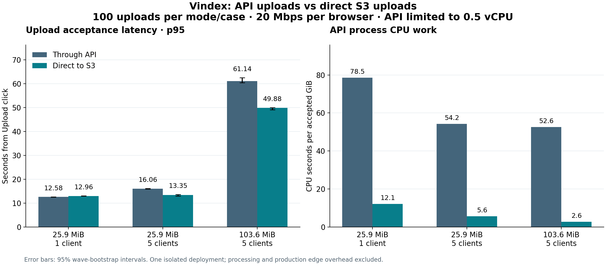

# Vindex upload architecture comparison — November 10, 2026

This report compares the retained API upload path with checksum-enabled direct S3 uploads in the same deployed application commit. It is an upload-path comparison, not a historical production A/B or a measurement of the processing DAG.

**Conclusion:** retain direct S3 uploads. With five simultaneous uploads, p95
acceptance latency fell 16.9–18.4%; API CPU work per accepted GiB fell 84.6–95.0%
across all three cases. A single upload was 3.0% slower at p95 (0.38 seconds),
within the predeclared 10% allowance. All 600 inputs and their initial jobs were
verified. This supports the upload design; it does not establish production
reliability, processing improvements or monthly billing savings.

## Completed comparison

Primary campaign: 2026-11-10T18:23:31.705747+00:00 through 2026-11-10T20:03:10.841332+00:00. Each of the three cases contains 100 attempts per mode (600 total). The four-upload pilot is excluded.

| File / concurrency | API p50 | Direct p50 | API p95 | Direct p95 | Direct/API p95 (95% paired-wave CI) | Latency gate |
| --- | ---: | ---: | ---: | ---: | --- | --- |
| 25.9 MiB / 1 client | 12.39 s | 12.74 s | 12.58 s | 12.96 s | 1.030 [1.025, 1.037] | passed |
| 25.9 MiB / 5 clients | 15.69 s | 12.84 s | 16.06 s | 13.35 s | 0.831 [0.810, 0.853] | passed |
| 103.6 MiB / 5 clients | 59.83 s | 48.81 s | 61.14 s | 49.88 s | 0.816 [0.791, 0.825] | passed |



Timing begins at the Upload click and ends at the durable acceptance response. It includes browser hashing, the S3 transfer, completion verification and the server-only input snapshot. Each concurrent wave stays together when bootstrapping; 100 concurrent attempts do not mean 100 independent waves.

## Server work

| Case | API body reduction | API CPU s/GiB: before → after | API CPU reduction | API + proxy CPU reduction | Write accounting: before → after |
| --- | ---: | ---: | ---: | ---: | ---: |
| 25.9 MiB / 1 client | 99.9991% | 78.54 → 12.09 | 84.60% | 88.44% | 5.060 → 0.000 GiB |
| 25.9 MiB / 5 clients | 99.9991% | 54.22 → 5.60 | 89.67% | 91.66% | 5.060 → 0.000 GiB |
| 103.6 MiB / 5 clients | 99.9998% | 52.56 → 2.65 | 94.97% | 96.04% | 20.240 → 0.000 GiB |

API request-body bytes are a logical ASGI payload count, not all billable wire traffic. API container RX/TX, proxy CPU, cancelled writes, RSS, memory growth and confidence intervals are retained in analysis.json. CPU includes instrumentation and background activity inside the measured wave.

Linux `write_bytes` counts pages marked for storage writes; truncation/deletion can cancel that work. The report preserves `cancelled_write_bytes` alongside it and does not equate this counter with physical disk writes or billed I/O. See the [kernel accounting definition](https://docs.kernel.org/filesystems/proc.html#proc-pid-io-display-the-io-accounting-fields).

## Correctness and acceptance gates

| Gate | 25.9 MiB / 1 | 25.9 MiB / 5 | 103.6 MiB / 5 |
| --- | --- | --- | --- |
| Accepted bytes and initial jobs | passed | passed | passed |
| Per-wave cleanup | passed | passed | passed |
| Observed acceptance ≥99% | passed | passed | passed |
| API body reduction ≥99% | passed | passed | passed |
| Write accounting reduction ≥95% | passed | passed | passed |
| p95 no more than 10% slower | passed | passed | passed |

| Case | API accepted / attempted | Direct accepted / attempted | Descriptive 95% interval per mode |
| --- | ---: | ---: | --- |
| 25.9 MiB / 1 client | 100 / 100 | 100 / 100 | API [0.963, 1.000]; direct [0.963, 1.000] |
| 25.9 MiB / 5 clients | 100 / 100 | 100 / 100 | API [0.963, 1.000]; direct [0.963, 1.000] |
| 103.6 MiB / 5 clients | 100 / 100 | 100 / 100 | API [0.963, 1.000]; direct [0.963, 1.000] |

Every accepted input is retrieved from S3 and checked against the original SHA256 and byte count after its measured wave. Verification requires one logical video, one completed reservation and exactly two pending initial jobs (search and playback). The wave then removes its test objects and database rows.

A 99% population reliability lower bound remains **unverified**. The Wilson intervals are descriptive and assume independence that concurrent/repeated-file trials do not establish. No p99 or maximum sustainable throughput claim is made.

## Controls and reproducibility

- Application commit: `a458bc2e5b19335025eed8ec63599e2c02297330`; identical API image for both modes.
- Image digest: `sha256:ee08240512c0f2b5b0101261ba74e4bd0aeccaba71519592c788647d9d50dcbc`.
- API: 0.5 vCPU / 2 GiB container on isolated t3.large. PostgreSQL uses a separate container on the same host (0.5 vCPU / 768 MiB); dispatcher and workers are absent.
- HTTPS: separate Caddy container, limited to 0.5 vCPU / 128 MiB. API and proxy CPU are both reported; Caddy digest is recorded in the environment evidence.
- Client: separate c7i.xlarge, Playwright Chromium 156.0.8078.80, Node 22.23.4. Fixed browser image digest and runner source hashes are in remote-raw.zip.
- Browser network emulation: 20 Mbps upload, 100 Mbps download, latency setting 40 ms. Both hosts are in us-east-1b; emulation is not an independent consumer last-mile connection.
- Files: synthetic 1280×720 H.264/AAC, 27,164,499 bytes / 20 seconds and 108,652,341 bytes / 80.07 seconds. The larger file is a lossless concatenation; corpus variety is limited.
- Single-client case: 100 paired waves. Each five-client case: 20 paired waves. AB/BA order alternates within each case. Fresh browser contexts are prepared before each measured wave.
- Statistics: nearest-rank p50/p95; 10,000 paired-wave bootstrap resamples, seed 20261109. Confidence intervals describe this run; gates were recorded before the replacement run.
- Authentication uses the same isolated test identity for both modes behind restricted access. Cognito, CloudFront and API Gateway are excluded. Production API Gateway cannot proxy the large legacy bodies; its rejection is not used as a speed comparison.

The [predeclared protocol and amendments](upload_comparison_protocol_2026-11-09.md) document the sample sizes, gates, replacement runner and upstream-TLS layout. The [analysis JSON](evidence/upload_comparison_2026-11-10/analysis.json) includes every cell and metric.

To reproduce the analysis, extract remote-raw.zip and run from backend/:

```text
python benchmarks/analyze_upload_comparison.py --campaign <extracted>/primary --output <analysis.json>
```

Use Python 3.11 and NumPy. The raw archive contains all attempts, wave resource snapshots, verification records, settings, completion markers and the remote SHA256 manifest. It contains no session tokens or signed upload policies.

## Interrupted attempt and scope limits

The earlier Windows-runner campaign stopped during its medium-file cell. It recorded 200 completed small/five-client attempts and 50 accepted/verified medium attempts, with five additional in-flight direct intents found in residual metadata. Its incomplete campaign is preserved separately in interrupted-raw.zip; none of its rows are pooled with the completed remote dataset. The exact cause of the local runner loss is not established.

The replacement changes the client hardware/browser and HTTPS termination together. Cross-run differences cannot be attributed solely to TLS placement. Only within-run API/direct comparisons support the primary conclusions.

Processing latency, search throughput, 450 MiB files, ten simultaneous clients, slow consumer hardware, multiple regions and broad real internet conditions remain unmeasured. The prior deployed smoke passed functional search/playback checks; that is not an integrated performance comparison. Monthly AWS savings remain unverified because fixed provisioned capacity may remain unchanged and direct uploads add S3 operations.

## Test resource closure

The final report archive was downloaded and checked against every recorded SHA256 before teardown.

Teardown completed at 2026-11-10T20:06:09.886782+00:00. Read-only checks confirmed both EC2 instances terminated, both root volumes removed, and the dedicated bucket, two security groups, role and instance profile absent. Production /health returned 200.

The replacement run's EC2 list-price estimate through teardown completion is **$0.466**. This is compute only, not an AWS bill: it excludes EBS, public IPv4, S3 operations/storage/transfer, taxes, discounts and the earlier interrupted host. Rates were read from the AWS Price List API (t3.large $0.0832/hour; c7i.xlarge $0.1785/hour). The [cleanup receipt](evidence/upload_comparison_2026-11-10/cleanup-verified.json) contains the runtime calculation and service counts; [pricing evidence](evidence/upload_comparison_2026-11-10/pricing.json) records the quoted rates. See [AWS On-Demand pricing](https://aws.amazon.com/ec2/pricing/on-demand/).

## Validation and retained artifacts

Fourteen focused Python safety/statistics tests and four Node measurement tests passed. Full repository CI passed on implementation commit 2bfff4e: [CI run](https://github.com/DavidQifongJiang/Vindex/actions/runs/42879010079). Independent review of the tests and protocol completed with no remaining findings after strengthening the clustering test and teardown regression. The reviewer excludes benchmark implementation files; this is not full implementation approval. The mutation check demonstrates that flattening concurrent clients would fail the regression test.

The earlier pilot inventory is also retained: the first pilot stopped during setup before recording an upload; the replacement local pilots recorded 4 and 20 successful attempts. These, the interrupted campaign and the remote four-upload pilot are excluded from the 600 primary measurements.

- [Remote raw results](evidence/upload_comparison_2026-11-10/remote-raw.zip): all primary/pilot attempts, resources, verification, completion markers and archive hash manifest.
- [Earlier interrupted run and pilots](evidence/upload_comparison_2026-11-10/interrupted-raw.zip): separate evidence, including the five preserved residual metadata objects.
- [Exact measured source files](evidence/upload_comparison_2026-11-10/measured-source.zip): bytes checked against the archived runner and server hashes.
- [Artifact checksums](evidence/upload_comparison_2026-11-10/SHA256.json), [analysis](evidence/upload_comparison_2026-11-10/analysis.json), [corpus hashes](evidence/upload_comparison_2026-11-10/fixtures.json), and [SVG chart](evidence/upload_comparison_2026-11-10/comparison.svg).
