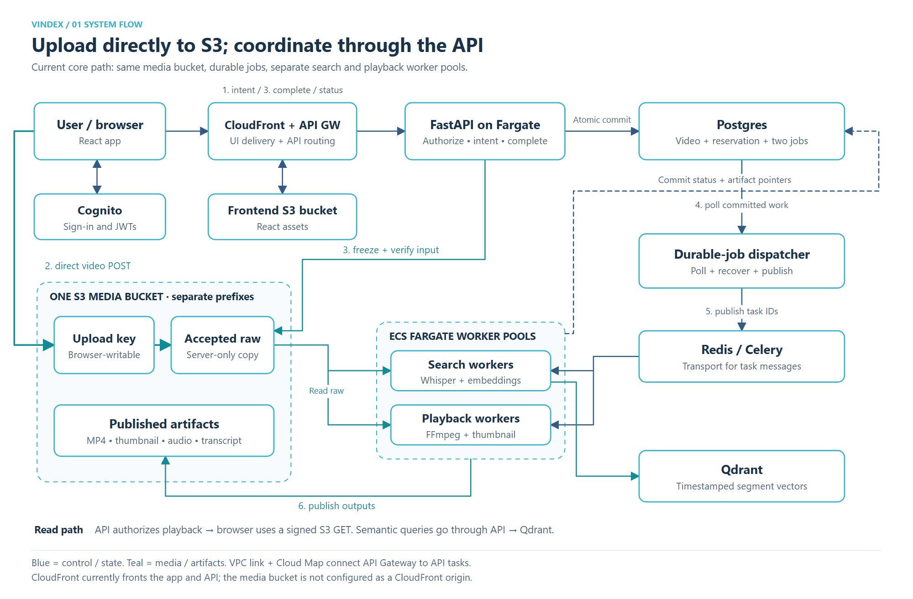
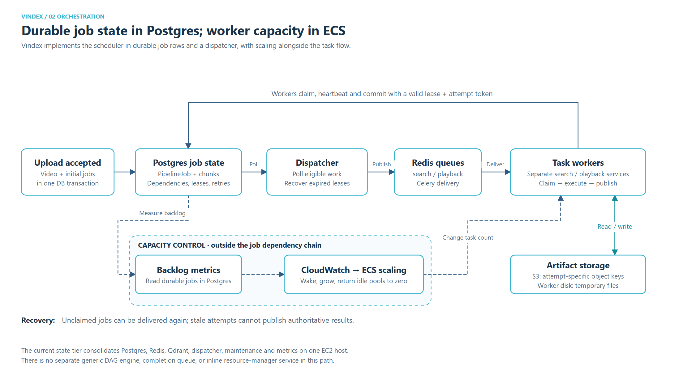
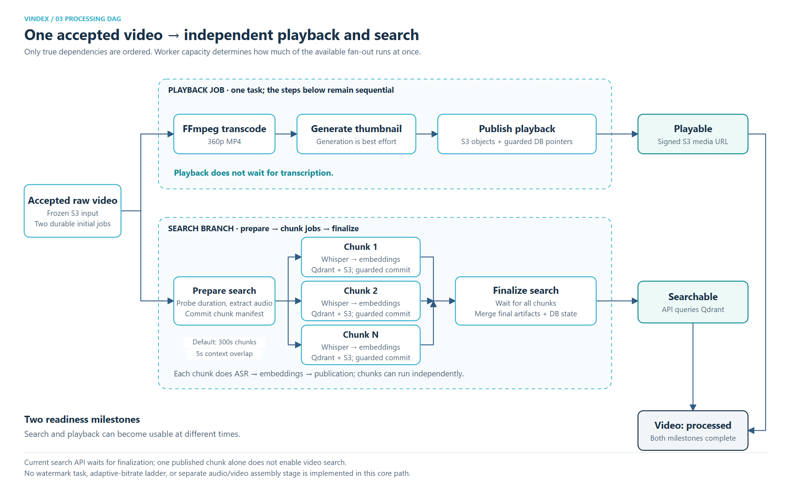

# Vindex versions of the three video-platform diagrams

Verified against application commit `a458bc2e5b19335025eed8ec63599e2c02297330`
and the repository's AWS configuration on November 11, 2026. These figures show
the implemented core upload, per-video search, and playback path. They do not
claim that every service is currently running, that optional features are enabled,
or that the ongoing benchmark has completed.

## 1. System flow



[Editable SVG](../diagrams/vindex-architecture-2026-11-11/01-system-flow.svg)

The browser requests an authorized upload intent, sends the media bytes directly
to S3, then calls the completion endpoint. The initial intent creates a durable
upload reservation. Completion copies the browser-writable upload to a server-only
key, verifies its size and supplied checksum, and atomically commits the accepted
video, completed reservation, and initial search/playback jobs. Processing reads
that accepted copy. S3 arrival alone does not schedule the video.

The API still handles authentication, authorization, metadata, acceptance, status,
search, and playback authorization. CloudFront fronts the React application and
API Gateway; VPC link and Cloud Map route to the FastAPI ECS service. Processed
media is currently delivered by signed S3 URLs, not a media-bucket CloudFront origin.
Original and generated media occupy different prefixes of one media bucket;
the frontend assets use a separate bucket.

Sources: [upload intent and completion](../../backend/app/api/videos.py),
[atomic job creation](../../backend/app/db/video_repository.py),
[upload reservation commit](../../backend/app/db/upload_repository.py),
[edge routing](../../infra/terraform/edge.tf),
[storage configuration](../../infra/terraform/storage.tf).

## 2. Scheduling and capacity



[Editable SVG](../diagrams/vindex-architecture-2026-11-11/02-orchestration.svg)

The equivalent of the reference's DAG scheduler is application dependency logic,
Postgres job/chunk rows, and the dispatcher. It is not a separate general-purpose
DAG engine. Redis carries Celery messages; Postgres owns eligibility, attempts,
leases, retry state, and the published artifact pointers. Workers claim and renew
ownership in Postgres and can publish authoritative results only while their
lease and attempt token remain valid. A broker delivery can repeat without
creating a second authoritative publication.

The equivalent of the reference's resource manager is ECS capacity management,
driven by CloudWatch backlog metrics. It operates alongside dispatch, rather than
being a synchronous stage that every task passes through. Configuration supports
independent search/playback scaling, including waking an empty worker pool and
returning an idle pool to zero. The current experiment holds capacity fixed; it
does not validate scale-from-zero latency or autoscaling behavior.

Temporary files live inside worker tasks. Durable audio, transcript, embedding,
and playback artifacts use attempt-specific S3 keys. Maintenance handles
reference-aware cleanup. The deployed state tier consolidates Postgres, Redis,
Qdrant, dispatcher, maintenance, and metrics on one EC2 host; API and worker
services run separately on Fargate. This is a shared state-host failure domain,
not a highly available distributed database/cache tier.

Sources: [dispatcher](../../backend/app/workers/pipeline_dispatcher.py),
[lease and publication rules](../../backend/app/db/pipeline_repository.py),
[durable task wrapper](../../backend/app/workers/durable_task.py),
[Celery routing](../../backend/app/workers/celery_app.py),
[autoscaling](../../infra/terraform/autoscaling.tf),
[state host](../../infra/terraform/state_host.tf).

## 3. Processing DAG



[Editable SVG](../diagrams/vindex-architecture-2026-11-11/03-processing-dag.svg)

Two jobs start from the same accepted raw input:

- **Playback:** transcode to a 360p MP4, generate a thumbnail, upload outputs, and
  publish their pointers. These steps execute sequentially inside one playback
  task. Thumbnail generation is best effort. The playback API becomes usable
  once the processed object is published, without waiting for transcription.
- **Search:** inspect duration, extract audio, and commit the chunk manifest.
  Each chunk independently performs Whisper transcription, timestamp adjustment,
  embeddings, Qdrant upserts, S3 artifact writes, and a guarded chunk completion.
  Once all chunks complete, a finalization job merges artifacts and marks search
  ready. The current per-video semantic-search endpoint waits for this final state.

The default logical chunk size is **300 seconds**, with up to **5 seconds of
context on either side**. Parallel chunk execution requires multiple available
search-worker slots. The current benchmark uses 20- and 80-second inputs and one
search worker, so it exercises parallel search/playback branches but does not
measure multi-chunk fan-out speedup. It compares two upload routes through the
same DAG, not the historical serialized pipeline against a new DAG.

The overall video status becomes `processed` when both search and playback are
complete. That final status is not an audio/video assembly step. Authorization,
durable acceptance, and real dependencies remain ordered.

Sources: [search preparation, chunks, finalization, and playback](../../backend/app/services/video_service.py),
[task entry points](../../backend/app/workers/task.py),
[finalization and overall readiness](../../backend/app/db/pipeline_repository.py),
[search and playback readiness checks](../../backend/app/api/videos.py).

## Differences from the supplied reference pictures

| Reference concept | Vindex's implementation |
| --- | --- |
| Upload to original storage, then transcoding | Authorized intent → direct S3 upload → explicit API completion → verified input snapshot → durable jobs |
| Original and transcoded storage boxes | One media bucket with distinct prefixes; frontend assets have a separate bucket |
| Load balancer in front of API servers | CloudFront → API Gateway → VPC link / Cloud Map → FastAPI on Fargate |
| Metadata cache + metadata database | Postgres owns durable state; Redis primarily transports Celery jobs in this path; Qdrant stores searchable vectors |
| DAG scheduler and inline resource manager | Application dependency logic + Postgres + dispatcher; ECS scaling is a separate capacity-control path |
| Transcoding completion queue and handler | Workers publish guarded database state directly; no separate media completion queue/handler |
| Parallel inspection, thumbnail, watermark, audio encoding | Playback runs separately from search; search supports chunk fan-out. Thumbnail follows transcode in the same task; no watermark branch |
| Separate metadata and inspection branches | Upload metadata is committed by the API; duration inspection is part of search preparation, without a separate metadata worker |
| Assemble encoded audio/video into a final product | Search finalization merges chunk artifacts; overall readiness joins search and playback status, not separate audio/video streams |
| Transcoded storage → media CDN | Current playback uses a signed S3 GET. CloudFront serves frontend/API traffic; no media origin or adaptive-bitrate ladder is configured |
| General video streaming focus | Timestamped transcription, semantic retrieval, and playable video are first-class outputs |

Feature-gated library search, search projections/Elasticsearch, and Kafka search
analytics exist outside this core path. The shared frontend configuration disables
library search and analytics; these diagrams do not represent them as enabled or
as mechanisms that trigger media processing. See
[frontend configuration](../../infra/frontend.production.env),
[projection feature gate](../../backend/app/db/search_repository.py), and
[Kafka plan](../kafka/kafka_search_analytics_plan.md).

## Regenerate

From the repository root:

```text
python docs/diagrams/vindex-architecture-2026-11-11/render_diagrams.py
node docs/diagrams/vindex-architecture-2026-11-11/render_png.cjs
```

PNG rendering uses the frontend's installed Playwright and Chromium. The SVG
sources are editable, keep real text, and require no Figma account. These commands
only create local figures and do not access the application or experiment host.
