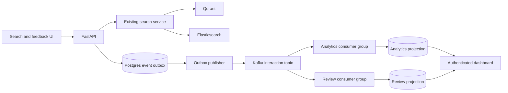

# Vindex Kafka search analytics and evaluation plan

Date: 2026-09-17. Status: validated local prototype; repeated-round latency acceptance remains open. See [validation results](kafka_validation_results.md) for current evidence and kafka_search_analytics_runbook.md for commands.

Accepted review revisions: defer live dashboard replacement and reviewer-entered
judgments; use seven-day analytics history; persist completion/context atomically;
use event-specific interaction validation; authorize reviewers by explicit server
allowlist; replay original quarantined bytes with a corrected handler, never edit
historical payloads in place. An independent subagent reviews implementation checkpoints.

## Outcome and rationale

Help the developer understand where semantic and keyword search fail, inspect
user-submitted examples, and rebuild derived reports after correcting their logic.
Build this as a bounded Vindex extension, not a third standalone application.

Kafka serves two independently operated consumers of retained search interaction
events: an analytics projection and an evaluation review queue. Independent
progress and replay are the reasons to evaluate Kafka. Current traffic has not
established a scaling requirement. A Postgres event table with separate consumer
cursors is a viable simpler alternative; the project deliberately includes Kafka
learning and failure experiments. Document infrastructure cost and limitations.

The feature does not establish that hybrid search improves relevance. Proposed
product policy is semantic/Qdrant by default, explicit keyword/Elasticsearch mode,
and hybrid available only for controlled experiments. At inspection, the library
API and frontend still default to hybrid; implementing the policy is phase 1.

## Scope and boundaries

- One versioned interaction topic, one publisher, and two consumer groups.
- An authenticated developer dashboard and a permission-checked review queue.
- JSON event contracts, SQLAlchemy/Alembic storage, Python workers, and a Compose
  profile. Pin compatible Kafka image and Python client versions at implementation;
  record image digest, client version, and effective settings in benchmark output.
- Preserve Postgres authority, Celery/Redis execution, accepted search projections,
  access checks, lease/token checks, and attempt-specific publication.
- No ranking changes, recommendation model, automatic intent classifier, Flink,
  Spark, Kubernetes, or replacement of the ingestion broker in this milestone.
- Local development and synthetic load first. Real user telemetry is opt-in.
  Cloud deployment and production-load claims are separate work.

## Architecture

Kafka is never called from the search request path. A bounded outbox write adds
some Postgres cost; measure it rather than claiming zero overhead. A Kafka outage
may delay analytics but must not prevent retrieval.

Search completion capture is best effort before durable acceptance: attempt the
outbox insert using a small dedicated connection budget and a configurable 25 ms
total capture deadline. If capture fails or admission is full, preserve the search
response and increment a low-cardinality capture-loss metric. No unbounded tasks
or in-memory queue. A process crash before commit can lose that observation.
Export capture-loss metrics through the existing monitoring path, independently
of Kafka; do not call captured events a complete log of all searches.

Feedback has a stronger contract: persist its private record and outbox row in
one transaction, then acknowledge it. On failure, return a retryable error and
let the UI show that feedback was not saved. A stable client event ID makes retries
idempotent. Search remains usable when feedback persistence is unavailable.

## Event and API contracts

Topic: `vindex.search.interactions.v1`. Initial partition count: 3. Partition key:
server-issued `search_id`, using the existing request ID. No global ordering claim.
Per-search partition placement does not guarantee business order: publisher
concurrency and retries can reorder related events, so consumers tolerate it.

Common envelope: `event_id` (UUID), `event_type`, `schema_version`, `search_id`,
`occurred_at` (server UTC), `recorded_at` (server UTC), `producer_version`,
`traffic_class` (`synthetic` or `opt_in`). Client timestamps are optional diagnostic
fields and never trusted for authorization or operational latency.

| Event | Source and fields | Interpretation |
| --- | --- | --- |
| `search.completed` | Server: requested/effective mode, HTTP status, elapsed ms, result count, degraded flag, coverage state, retrieval configuration version | A server-side outcome, not proof the browser displayed results |
| `search.results_viewed` | Browser: search ID and bounded displayed rank list, validated against stored results | Results rendered in the browser; count at most one impression per search |
| `search.result_opened` | Browser: search ID and result rank | User opened a result; server resolves the passage reference |
| `search.feedback_submitted` | Browser: search ID, optional rank, helpful/not helpful | Explicit feedback, not a human relevance judgment |

Persist a short-lived private search context with authenticated owner, exact
returned passage/revision references, mode, and expiry. Return an interaction
capability only if context persistence succeeds. Event intake must verify owner,
expiry, valid event type, rank membership, payload limits, and rate limits; never
trust a browser-supplied owner, engine, passage text, or result count. Revalidate
current video access when opening a review example. UUID possession is not access.

Proposed endpoint: `POST /search/{search_id}/interactions`, accepting a stable
`event_id`, type, optional rank, and optional feedback. A repeated identical ID
returns the original acceptance; a different payload for the same owner/event ID
is a conflict. Cap request size at 8 KiB and topic event size at 16 KiB.

Validate schemas at production and consumption. Additive optional fields remain
compatible; breaking changes require a new version and migration/replay plan.
Unknown event versions are quarantined, never silently scored as valid.

## Data minimization and evaluation usefulness

Kafka contains opaque search IDs and numerical/categorical metadata, not raw
queries, transcript text, names, email addresses, auth tokens, or playback URLs.
Opaque IDs are still sensitive and remain access restricted.

For a useful review example, separately ask whether the user wants to share the
query and referenced passages for evaluation. Store consent and the query in the
private Postgres context, not the topic. Feedback without content-sharing consent
can contribute aggregate signals but cannot create a content-bearing review item.
Only the owner and an explicitly authorized reviewer can see shared examples.
Resolve passage text through authoritative access/revision checks; if the passage
changed or was deleted, mark the example unavailable rather than substituting text.

Provisional retention: Kafka events 7 days (or earlier under a configured byte cap),
private context/shared examples 7 days, published outbox rows 7 days for retry
deduplication, analytics history 7 days. Unpublished outbox
rows have a configurable 7-day maximum age and 1 GiB logical payload budget;
enforce admission atomically, track oldest age, and explicitly count expirations.
Feedback intake rejects new events when full; search capture records loss.
Benchmark disk use, including indexes/WAL and Kafka segment overhead separately.

Deleting a user/video or withdrawing sharing removes private context and review
content and prevents replay from recreating it through consent/access checks.
Already produced opaque topic records expire by retention; do not promise
immediate physical per-record deletion from Kafka. Replay skips unavailable content
and reports the skip count. Local fixtures use synthetic identities and public
sample passages.

## Delivery, recovery, and replay

1. The publisher leases bounded outbox batches with claim tokens, publishes the
   original event ID, and marks delivered only after broker acknowledgement.
   Expired claims are retried with the same ID; stale tokens cannot mark delivery.
2. Use producer idempotence and `acks=all`, with bounded buffers/timeouts and
   backoff. These do not deduplicate a republished outbox event across restarts.
3. Consumer groups are `search-analytics-v1` and `search-review-v1`. Disable auto
   offset commit. Process each partition in order, committing only the next offset
   after its database transaction succeeds. Never commit beyond unfinished work.
4. In one Postgres transaction, insert a unique `(projection_generation, event_id)`
   receipt and update the derived state. On duplicate receipt, do not apply again.
   Commit Kafka offsets afterward. A crash in between redelivers safely.
5. On partition revocation, stop accepting that partition's work, finish or roll
   back bounded transactions, and avoid committing revoked assignments. Test a
   rebalance with work in progress. The database receipt remains the final guard.
6. Transient database failures pause processing and retry with backoff; keep polls
   alive within the client requirements. Malformed records are durably quarantined
   in Postgres with group/topic/partition/offset and error code before advancing.
   Quarantine is visible and excluded from clean-success claims. Re-drive through
   a controlled command after fixing the cause. Do not add a second topic in v1.
7. Projection receipts live as long as their generation. Never expire receipts
   while a generation remains eligible for replay; retire them with the projection.

Delivery is at least once for durably accepted, retained events under the tested
failure model. External database effects are idempotent, not a blanket exactly-once
system guarantee. Retention expiry, unrecoverable local disk loss, and capture
failures remain explicit loss boundaries.

Replay creates a fresh group and shadow projection generation. Record the earliest
available and target end offset for every partition, schema/config versions, and
input hashes for synthetic fixtures. Rebuild only that bounded range, validate
counts/checksums. Live dashboard replacement is deferred: the shadow result is
an offline comparison only. Saved manifests can pin the same range on later runs;
missing retained offsets fail explicitly. Retire inactive shadow generations using
the documented command. Replay covers retained
history only. Private review content may have expired independently.

## Two useful consumers

**Analytics:** per mode/configuration/time bucket, show request count, status/error
rate, incomplete/degraded coverage, zero-result rate, latency histograms, viewed
searches, opened searches, and feedback counts. Label histogram quantiles approximate.
Define click-through as distinct viewed searches with an open divided by distinct
viewed searches; show unmatched events separately. It is an engagement metric.
User-selected modes have different query mixes and cannot establish a causal winner.

**Evaluation:** create one review item per consented search with explicit negative
feedback or zero results on a nonempty, fully indexed library. Keep indexing and
availability failures in a separate operational category. Join events by search ID
regardless of arrival order; no click is not a relevance failure. A reviewer can
inspect consented examples; reviewer-entered judgments are deferred. This selected
queue diagnoses failures; an unbiased fresh query
set is still needed for overall Hit@1/Hit@5/MRR comparisons.

The UI uses Semantic and Keyword labels. Engine names and Kafka controls belong
in the developer view, not the normal search experience. Dashboard freshness,
capture losses, quarantine counts, and replay range must be visible.

## Implementation phases

Effort estimates are planning ranges, not deadlines; roughly 9-13 focused working
days, depending on infrastructure and test failures. Every phase ends with a
reviewable artifact before proceeding to the next.

| Phase | Work | Completion evidence |
| --- | --- | --- |
| 1: Search policy and contracts (1 day) | Qdrant default in API/frontend; explicit Keyword selection; hybrid experimental; freeze schemas, metric definitions and alternative analysis | Default/mode tests, frontend build, sample valid/invalid events, short design decision record |
| 2: Durable capture (1-2 days) | Alembic tables, bounded search capture, private consented context, authenticated interaction intake and idempotency | Unauthorized/spoofed input tests; capture-failure isolation; atomic feedback/outbox test |
| 3: Kafka transport (1-2 days) | Optional local Compose profile, explicit topic bootstrap, leased publisher, version/config manifest | Broker outage accumulation/recovery; duplicate publish window test; bounded storage behavior |
| 4: Projections (2 days) | Analytics and review consumers, atomic receipts, event joins and quarantine | Independent consumers; duplicate/reorder/rebalance tests; correct review/access behavior |
| 5: Product view and replay (1-2 days) | Dashboard, review page, generation-based replay command and runbook | Replay checksum equality on frozen synthetic fixture; UI screenshots/build; deletion and consent tests |
| 6: Failure/load evidence (2-3 days) | Controlled workloads, crash injection, on/off capture timing, reports and demo | Reproducible benchmark package with pass/fail/missing gates and limitations |

Expected implementation locations: `app/api/search.py`, a new interaction route,
`app/services/search_events.py`, `app/db/search_event_repository.py`, new models
and Alembic migration, `app/workers/search_event_publisher.py`,
`app/workers/search_analytics.py`, `app/workers/search_review.py`,
`frontend/src/LibrarySearch.tsx`, a developer analytics view,
`ops/compose/docker-compose.analytics.yml`, focused `tests/test_search_events*.py`, and
`benchmarks/search_event_stream.py`. Names are proposals, not existing modules.

## Verification and acceptance gates

These are proposed local targets, not claims of current capability. Freeze workload,
hardware, resource limits, topic/client settings and seeds before measured runs.
Report unsuccessful attempts, not only successful timings. Target changes need an
explicit recorded rationale and a new baseline; do not silently lower gates.

| Gate | Workload / pass criterion |
| --- | --- |
| Functional demo | Search in both modes, view/open/feedback, analytics update and consented review item; no cross-owner access |
| Accounting | On a valid synthetic fixture, every durably accepted event is accounted for; zero missing projection effects and zero duplicate effects |
| Stream capacity | 100 synthetic events/s for 30 min (180,000 events); both groups active; healthy projection-freshness p95 <= 5 s; report CPU/RAM/disk |
| Search overhead | Three paired on/off runs, >= 1,000 searches per condition each, same corpus/hardware and four clients; total client p95 increase <= 10% and <= 20 ms; no new search failures |
| Consumer outage | Stop one group for 60 s at 100 events/s; other continues; stopped group catches up within 120 s after restart with exact accounting |
| Broker outage | Stop broker for 60 s; accepted outbox events survive and drain within 120 s of recovery; search availability preserved; capture losses explicitly reported |
| Crash windows | Kill publisher after broker ack/before outbox mark and consumer after DB commit/before offset commit; verify no duplicate database effects |
| Bad input and reordering | Quarantine malformed/version-unknown input visibly; recover after fix; interaction-before-completion produces consistent joins |
| Replay | Same frozen retained offsets into a fresh generation yield equal aggregates/review identifiers for still-authorized fixture content; repeated delivery changes nothing |
| Boundaries | Outbox budget exhaustion, context expiry, offset retention loss and consent withdrawal yield explicit errors/skip counts without silent complete-data claims |

A single local KRaft broker proves restart recovery, not replication or high
availability. Start there with replication factor 1 and minimum ISR 1. Optional
follow-up: three local brokers, replication factor 3/minimum ISR 2, one-broker loss
and two-broker-loss write rejection tests. Containers on one machine do not prove
host/zone fault tolerance. Keep partition count fixed within benchmark/replay runs.

Use unit tests for event validation/state transitions and real isolated Postgres
and Kafka integration tests for commit/crash/rebalance semantics. Run Python 3.11
checks and Node 22 frontend build in CI. Missing integration dependencies produce
an explicit unverified gate, not a passing reliability claim.

## Rollout, rollback, and deliverables

Separate flags for capture, interaction intake, publisher, consumers, and dashboard;
all off by default until local verification. Schema migration is additive. Stop
capture/intake first on rollback, then drain or retain the outbox under its documented
retention budget. Stop publisher/consumers without altering search execution.
Disabling the analytics profile must not disable Qdrant/Elasticsearch search.

Deliver: architecture/decision record, schema examples, migration and rollback
instructions, reproducible fixture/load commands, failure timeline, replay manifest,
latency/throughput/resource report, and a short demo recording. Use Kafka access
controls and protected listeners before any nonlocal deployment; do not expose
local development listeners publicly.

The interview claim after completion is: implemented independent analytics and
evaluation consumers with retained-event replay and tested idempotent recovery.
Attach actual numbers and environment. Do not claim production scale, improved
relevance, or high availability from this local project.

## References

- Current Vindex search path: `app/api/search.py`, `app/services/library_search.py`.
- Current telemetry: `app/services/search_observability.py`; contains no query text.
- Existing durable execution: [reliability and recovery](reliability_and_recovery.md).
- Relevance evidence limits: [search quality work plan](search_quality_work_plan.md).
- [Apache Kafka design and delivery semantics](https://kafka.apache.org/41/design/design/).
- [Producer settings](https://kafka.apache.org/41/configuration/producer-configs/).
- [Consumer settings](https://kafka.apache.org/41/configuration/consumer-configs/).

Kafka 4.1 documentation above is a versioned semantic reference, not a selection
of the runtime version. Verify settings against the pinned client/broker chosen
in phase 3; client option names and behavior can differ.
