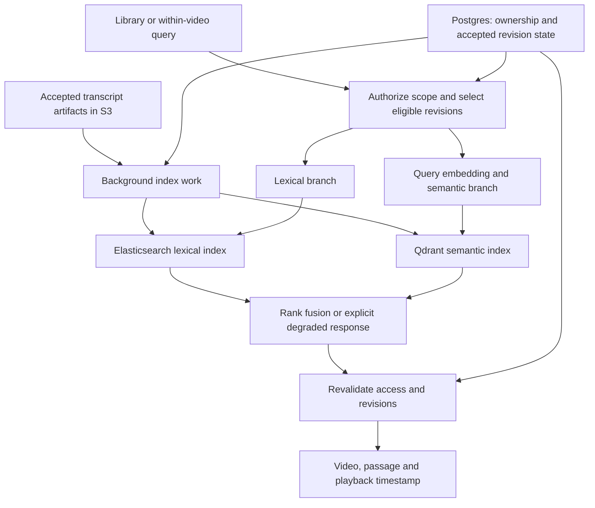

# VIndex: Elasticsearch and library-wide hybrid search roadmap

Status: phase 5 local evaluation and observability delivered; rollout held pending
independent relevance judgments and deployment-specific evidence. See
[phase 5 results and rollout decision](search_phase5_evaluation.md),
[phase 4 UI and evidence](search_phase4_ui.md),
[phase 3 API and evidence](search_phase3_api.md),
[phase 2 operations and evidence](search_phase2_operations.md)
and the [implementation specification](search_implementation_spec.md).
This document records agreed behavior and proposed implementation phases; it does
not authorize deployment or treat the unfinished local code as a completed phase.

## Product goal

Help a user find the right passage across their videos, including technical terms
and phrases that semantic retrieval may rank poorly. Retain search inside one
video. Improve retrieval quality and evaluate request efficiency independently:
adding Elasticsearch is not evidence of either a quality or latency improvement.

“Dijkstra Fibonacci heap” is an illustrative query, not a verified failure in the
current corpus. The first phase must identify and preserve actual wrong matches.

## Agreed decisions

| Area | Agreement |
| --- | --- |
| Search engines | Elasticsearch for lexical retrieval alongside Qdrant for semantic retrieval |
| Search scope | Library-wide search while retaining within-video search |
| Hybrid execution | Execute the two branches concurrently and combine rankings |
| Query failure | Return the surviving branch with an explicit degraded status; both failures produce a temporary-unavailability error |
| Empty results | A successful empty result is not a dependency failure |
| Authorization | Access and accepted-revision validation are mandatory; neither may be bypassed during fallback |
| Publication | An incomplete index revision must not become searchable; one engine's readiness does not imply the other's |
| Incomplete indexing | Return available current-revision results with a clear processing/indexing notice; admit each video separately per ready backend |
| Delivery infrastructure | Use existing background-processing infrastructure initially; no Kafka requirement |
| Collaboration | Review consequential design choices together before implementing the next block |

Confirmed initial product scope: authenticated **My library** means the current
user's uploaded videos. Existing public-video access remains, but merging public
and private libraries is not implied. Collections/folders, transcript editing,
recommendations, OCR, Kubernetes and C++ are outside this release.

## Current evidence and unfinished work

- The current application search route requires a video ID. Qdrant supports the
  semantic branch; Python BM25 builds a lexical index from S3 segments during a
  request. Existing hybrid execution is sequential.
- Historical 100-query, within-video results: dense Hit@1/Hit@5 65%/90%, Python
  BM25 74%/98%, Elasticsearch BM25 74%/99%. These are not library-wide results,
  held-out improvements, or concurrent API performance measurements. See
  [retrieval experiments](../../benchmarks/retrieval_experiments.md).
- Existing durable pipeline, attempt fencing and operational monitoring remain
  the foundation. See [recovery design](reliability_and_recovery.md).
- Local edits were started before the design discussion: `lexical_index.py`,
  `lexical_reconciliation.py`, API/maintenance wiring, UI options, Compose/config,
  an alert rule, benchmark changes and `test_lexical_index.py`. These are provisional.
  They do not implement library search, concurrent retrieval or graceful degradation.
- The earlier focused run executed 23 tests: 22 passed and one real Elasticsearch
  test failed on a 409 version conflict during deletion after index repair. The
  refresh/publication/deletion interaction remains unresolved; do not enable this
  code as a finished integration. A full frontend build also failed because the
  sandbox denied esbuild filesystem access; a successful frontend build is pending.
  Compose configuration validation passed. No deployment or new benchmark claim
  follows from these checks. These are prior results, not tests rerun for this plan.
- The working tree contains substantial pre-existing uncommitted work. Record a
  source snapshot/diff at the start of implementation; preserve unrelated changes.

The architecture direction here supersedes the earlier roadmap's suggestion to
defer selecting a lexical backend. Acceptance still depends on measured benefits.

## Proposed architecture, subject to the phase 1 review

This is a target design, not the current pipeline. Today Qdrant writes occur
during chunk processing; making both branches consume accepted artifacts requires
an explicit migration decision. Do not silently change video readiness semantics.

## Phase 0 — establish a reproducible baseline and real failure set

Purpose: identify the actual retrieval problem before tuning the new engine.

Inputs: existing complete segment corpus, recorded labels and current retrieval
code. Preserve corpus hashes, model versions, filters, source revision and hardware.

Deliverables:

- Audit representative failures and classify wrong-video matches, wrong passages,
  exact-term misses, transcription mistakes and ambiguous relevance labels.
- Create global-search labels containing relevant video IDs and passages, allowing
  multiple valid answers. Do not just remove the known video ID from old labels
  without checking other videos for valid answers.
- Include exact terms, phrases, paraphrases, similar-topic distractors and
  unanswerable questions. Separate development and held-out queries before tuning.
- Establish an offline library-wide dense baseline with the same accepted corpus.
  Measure the existing within-video API separately; do not label offline timings
  as library API latency.

Likely files: `benchmarks/export_search_corpus.py`, existing benchmark helpers,
versioned library labels/config, and a baseline report under `benchmarks/`.

Acceptance: reproducible baseline, inspected actual failures, documented label
limitations, and proposed quality/latency criteria to review together. No numerical
improvement target is asserted in advance of baseline evidence.

## Phase 1 — agree on scope, identity and consistency contracts

Design and domain-contract code delivered following the user's instruction to proceed. See
[phase 1 contracts](search_phase1_contracts.md) and
[implementation decisions](search_phase1_decisions.md) for source findings, API
examples, the state matrix, migration plan and contract-test inventory. Phase 0
measurements are still pending; phase 2 indexing implementation has not started
under this approval. Phase 1 implements canonical contracts, response policy and
rank-fusion identity safety. Earlier provisional Elasticsearch lifecycle code is
not a completed implementation.

Purpose: make library search safe and define precisely what each index represents.

Proposals to review:

- Authenticated My library first; no implicit search across other users' uploads.
- One shared Elasticsearch passage index per schema generation, rather than one
  index per video. Analyzer, shard/replica settings and generation-switch mechanics
  are reviewed choices, not defaults inherited from the prototype.
- Stable passage identity containing video, canonical transcript revision and
  passage identity. Define a mapping from current Qdrant chunk/attempt payloads;
  legacy `(start, end, text)` fusion identity needs a scoped migration strategy.
- A canonical accepted revision and separate readiness for each engine. Readers
  never combine incompatible revisions for the same video. Pending coverage must
  be reported distinctly from an engine outage; exact API/UI treatment is a review
  decision. Never silently substitute an obsolete revision.
- Authorization and generation filters before top-k retrieval, followed by a fresh
  authoritative check before returning passage text or playback metadata. A failed
  authorization dependency fails closed, even if one search engine is healthy.
- A bounded authorized-ID/revision filter can serve the first small library. State
  and enforce the tested size limit; do not claim this is an unbounded tenant design.

Deliverables: request/response examples, passage schema, readiness/state diagram,
deletion contract and the selected indexing mechanism. Choose between the existing
maintenance reconciler and durable indexing jobs using freshness/retry needs; retain
periodic reconciliation for repair either way.

Likely files: `app/services/lexical_index.py`, `app/services/qdrant_service.py`,
`app/services/hybrid_search.py`, API schemas, and DB/migrations only if agreed state
requires them. Proposed new library search orchestration belongs in an application
service rather than growing the existing route handler.

Acceptance: both engines address the same eligible passages; ownership, deletion,
legacy payloads and revision changes have explicit behavior and test cases.

## Phase 2 — complete the Elasticsearch indexing lifecycle

Purpose: make lexical search continuously maintainable from authoritative data.

Deliverables:

- Index accepted artifacts automatically and backfill existing videos without
  retranscription. Bound batches, concurrency, resource use and retry pressure.
- Use deterministic identities and idempotent writes; distinguish transient
  failures from malformed content. Exhausted work is visible and deliberately
  retryable, rather than retried invisibly forever.
- Publish readiness only after all expected items succeed and are search-visible.
  Define concurrent publishers, acknowledgement loss, refresh behavior and repair.
- Resolve the known delete/refresh failure. Test late writes after deletion,
  deletion during indexing, obsolete generations and multiple reconcilers.
- Exclude deleting videos immediately through authoritative filtering; retry
  physical cleanup and collect orphaned revisions. Do not claim an atomic
  transaction across Postgres, S3, Qdrant and Elasticsearch.
- Provide bounded index repair and a rebuild procedure. Count-only repair cannot
  detect arbitrary content corruption; specify the intended verification strength.
- Add indexing health, retry, freshness and cleanup metrics and useful error logs.

Likely files: lexical index/reconciliation services, maintenance or task integration,
operational metrics/alerts, configuration, and focused lifecycle tests.

Acceptance: real Elasticsearch tests for partial bulk writes, repeated delivery,
repair, concurrent publication and deletion pass. A failed lexical index does not
break playback or otherwise healthy semantic search. No shared user index is used
as a destructive test fixture.

## Phase 3 — implement library retrieval and explicit degradation

Purpose: serve safe library-wide lexical, semantic and hybrid requests.

Deliverables:

- Proposed `POST /search` for My library; retain the existing within-video endpoint
  and share orchestration where practical. Return video identity/title, passage
  identity, timestamps and text, with deterministic bounded result ordering.
- Encode a query once. Issue bounded library queries rather than one request per
  video. Establish the library Qdrant API baseline before comparing Elasticsearch.
- Start lexical retrieval and query-embedding/semantic retrieval concurrently.
  Include embedding in the semantic deadline and account for authorization,
  validation and response assembly in the overall request budget.
- Use rank fusion when both branches succeed. Keep the surviving branch's order
  during fallback. Review candidate counts, fusion parameters and adjacent-hit
  grouping against development data; freeze them before held-out evaluation.
- Use bounded concurrency and admission. A caller timeout alone does not stop
  blocking work: choose clients/executors with explicit request timeouts and avoid
  accumulating abandoned requests or retry storms.
- Define response fields such as `requested_mode`, `effective_mode`, `degraded`,
  branch status and coverage status. Keep internal exception details out of user
  messages. One successful empty branch plus one failed branch is a degraded empty
  response, not evidence that the full library contains no answer.

| Hybrid branch outcomes | Required behavior |
| --- | --- |
| Both succeed | Rank fusion; empty successful branches are valid |
| Semantic fails/times out | Lexical results with degraded status |
| Lexical fails/times out | Semantic results with degraded status |
| Both fail/time out | Temporary-unavailability response |
| Scope or revision validation cannot be completed | Fail closed; no unvalidated content |

Single-engine requests do not silently invoke a different engine. Pending-index
coverage is separate from the failure table and follows the phase 1 contract.

Likely files: library search application service, API routes, Qdrant filtering,
lexical query methods, fusion helpers, and API/authorization/concurrency tests.

Acceptance: tests prove cross-user isolation, accepted-revision filtering,
concurrent execution, branch deadlines, both-failed handling, empty results and
revocation/deletion during a request. Measure wall-clock API latency rather than
only internal engine timers.

## Phase 4 — deliver the search experience

Purpose: let users find a passage without choosing its source video first.

Deliverables:

- A Search my videos entry point with result title, contextual text, timestamp and
  play-at-timestamp action. Retain Search this video.
- A concise fallback message, such as “Showing keyword results. Semantic search is
  temporarily unavailable.” Distinguish indexing, no matches and service failure.
- Review whether mode selection is a user control or a developer evaluation tool;
  keep implementation names out of ordinary user choices.
- Optionally add highlighting after retrieval correctness. Render snippets safely;
  never trust index-supplied markup as arbitrary HTML.

Likely files: `frontend/src/App.tsx`, `frontend/src/api.ts`,
`frontend/src/types.ts`, and associated styles/components.

Acceptance: successful frontend build and a browser journey covering library
search, passage playback, within-video search, degraded output and no-result states.

## Phase 5 — evaluate and stage a reversible rollout

Approved metric clarification following the all500 caption run: primary quality
is passage-level Hit@1, Hit@5, and MRR@5 using grade2 answers. Graded nDCG@5 is
secondary. Report p50/p95 latency and request errors separately; measure correct
and incorrect abstention only with verified query-level answerability labels.
Source-lecture matches are diagnostic, not answer accuracy. Unknown passage
judgments must not be treated as irrelevant, and human-verified labels must stay
distinct from AI drafts. See the [metric protocol](../benchmarks/library_queries_500/metrics_protocol_v1.json)
and [current scorecard](../benchmarks/library_queries_500/primary_metrics_scorecard.md).
This clarification was approved after retrieval execution, not preregistered.

Purpose: establish whether Elasticsearch delivers the intended benefit.

Comparison: dense-only, lexical-only and hybrid on identical accepted passages and
permissions. Keep the historical per-video Elasticsearch experiment separate:
shared-index corpus statistics and analysis can change rankings. Phrase boosts or
analyzer changes are explicit experiments, not evidence-free defaults.

Report:

- Video and passage relevance, Hit/Recall@k and MRR or nDCG, localization accuracy,
  no-answer behavior and breakdown by query type.
- End-to-end latency, throughput, errors, cold/warm behavior, CPU/memory, indexing
  freshness, index size and resource cost. Separate request concurrency from users.
- Full-hybrid success, degraded success and complete failure separately. Measure
  coverage as well as engine availability; do not mask incomplete libraries behind
  healthy dependency checks.
- Traces spanning scope resolution, query embedding, both engines, fusion and
  revalidation; structured logs with correlation IDs. Avoid transcript/query text
  by default and unbounded metric labels.

Failure/load scenarios: healthy mixed ingestion/search; each engine slow or down;
embedding failure; both paths down; partial indexing; crash/restart; rebuild while
uploads continue; delete/revision races; resource saturation and recovery.

Acceptance: held-out results meet the criteria agreed after phase 0; all security
and publication invariants pass; latency/resource tradeoffs are disclosed. A small
sample cannot support strong p99 or availability claims. If hybrid does not improve
the target use cases enough, retain it as an optional mode or revise the design.

Rollout: isolated local validation, then a reviewed staging configuration and
limited activation. Preserve a semantic-only rollback path and versioned index
cutover procedure. Production activation, paid infrastructure and retiring old
indexes are separate concrete decisions; do not perform them as part of this plan.

## Decisions and user input

Nothing blocks drafting or preparing the baseline specification. Use the existing
lecture corpus first. Extra examples of searches that disappointed the user are
helpful but not required to begin inspecting results.

| When | Decision to make together |
| --- | --- |
| Before phase 0 implementation | Approve the bounded baseline/failure-analysis block and its proposed files/tests |
| After baseline inspection | Confirm target failure categories and freeze quality/latency acceptance criteria |
| Before phase 1 closes | Confirm My library scope, revision/readiness semantics, shared schema and indexing mechanism |
| Before phase 3 | Agree deadlines, coverage/fallback response contract and overload behavior |
| Before phase 4 | Choose search placement, mode controls and fallback wording |
| Before staging/production | Review measured results, resource budget, security settings and rollback |

Do not request all these decisions upfront. Present evidence and a concrete
recommendation at the relevant phase. This roadmap creates no scheduled automation
and makes no application or deployment changes.
