# Phase 1: library search scope, identity and consistency contracts

Status: phase 1 design and domain-contract code delivered following explicit coding
authorization. See [implementation specification](search_implementation_spec.md).
User-confirmed product behavior and engineering design choices are distinguished
below. This is the implementation specification, not a claim of deployed behavior.
No migration, index mutation, benchmark or deployment accompanies this phase.
Rank fusion now consumes the implemented canonical contracts; library HTTP execution
and projection persistence remain later implementation blocks.

Parent: [Elasticsearch search roadmap](elasticsearch_search_roadmap.md).
The baseline/failure study (phase 0) has not been completed in this sequence.
Design work may proceed, but measured relevance/latency acceptance still depends
on that study. Do not treat design approval as performance evidence.

## 1. Scope and authority

Confirmed by the user: authenticated **My library** contains only
videos owned by the signed-in user, including their public uploads. Public videos
owned by others are not automatically included. Existing individual public-video
access continues. Collections and library-wide anonymous public search are future
scope. Client-supplied owner IDs never determine authorization.

Authority boundaries:

| Data | Authority |
| --- | --- |
| Ownership, visibility, deleting state | Postgres video row |
| Current accepted transcript revision | Postgres revision pointer |
| Transcript passages and provenance | Immutable, checksummed S3 manifest referenced by that revision |
| Published index attempt for a backend | Postgres projection state |
| Search scores and candidates | Elasticsearch or Qdrant; never authority for access |

Permissions are applied before top-k, not just after retrieval. Revalidate video
access, deletion state, current revision and projection identity before exposing
text/title/playback metadata. If Postgres validation fails, fail closed. The final
check is a request-time observation, not a guarantee against a permission change
after the response has been sent.

## 2. Source findings that shape the contract

- `video_service.adjusted_chunk_segments` creates segment IDs such as `2:17` and
  millisecond-rounded video timestamps. The finalizer merges accepted chunk
  manifests and writes attempt-specific final paths before updating Postgres.
- `qdrant_service.upsert_segments` writes vectors before chunk acceptance. Payloads
  contain video/time/text and optional chunk/attempt, but omit `segment_id`.
  Current reads use accepted chunk attempts to fence obsolete vectors.
- `hybrid_search.segment_key` is `(start, end, text)`. This is not a library-wide
  identity: two videos can have identical text and timestamps.
- The provisional lexical index uses a hash of video ID and final manifest path.
  Its readiness marker lives in Elasticsearch. That alone is insufficient for
  authoritative library-wide eligibility and cross-engine revision agreement.
- Existing `PipelineJob` is unique by video/stage. It does not represent multiple
  transcript revisions, index generations or backend-specific retry lifecycles.

## 3. Canonical transcript and passage identity

Revision identity: server-generated UUID persisted once when accepting a
transcript. Record video ID, immutable segments manifest path, SHA-256 of its exact
bytes, passage-schema version, ordered passage count and source chunk provenance.
The UUID is an identity, not a chronological version; currentness comes from the
Postgres pointer. Checksums detect mutation but are not chronological ordering.

For existing content, register its currently accepted manifest once under a unique
video/manifest reference after verifying it has not changed. A different manifest
or changed content requires a new revision. Do not hash timestamps/text alone to
decide that unrelated passages are the same.

Freeze an ordered canonical passage manifest. Preserve current passage boundaries
for this integration so lexical effects are not confused with rechunking effects.
Each entry includes:

| Field | Contract |
| --- | --- |
| `video_id`, `revision_id` | Authoritative video and immutable transcript identity |
| `passage_id` | UUIDv5 using a fixed application namespace and canonical JSON array of video ID, revision ID and ordinal |
| `ordinal` | Zero-based position in this immutable manifest; repeated identical text remains distinct |
| `start_ms`, `end_ms` | Finite nonnegative integer milliseconds; end is not before start |
| `text` | Exact accepted passage text; query analysis does not modify source text |
| `source_segment_id`, `source_chunk_index`, `source_attempt` | Provenance when available; not a substitute for global passage identity |

Pin the passage namespace to `1a3feaf4-27c1-54d7-b16c-c053c7c465c0` (UUIDv5 of
`urn:vindex:canonical-passage:v1` in the URL namespace). Encode the identity tuple
as compact JSON `[video_id, revision_id, ordinal]` with separators `,` and `:`,
lowercase canonical UUID strings and an integer ordinal. Freeze fixtures in
implementation tests so formatting changes cannot silently change passage IDs.
Changing passage order, boundaries or text creates a new revision. Reject malformed
times/text before publishing; define legacy float-to-millisecond conversion and
test boundary rounding during migration. API playback seconds derive from these
milliseconds. No new sentence merging is part of this block.

Both engines return `video_id`, `revision_id`, `passage_id`, projection identity,
timestamps and text. Fuse by `passage_id`; assert matching video/revision and source
content for duplicate identities. Never merge passages from different revisions.
Physical index write IDs additionally include the projection attempt, as below.

## 4. Index topology and attempts

Design choice: one shared Elasticsearch passage index per schema generation,
not one index per video. Initial indexed content is transcript text only. Title
search, phrase boosting, synonyms, stemming and typo tolerance are subsequent
controlled experiments. Return current display titles from Postgres.

Proposed baseline: standard text analysis with BM25, explicit keyword fields for
identities, integer timestamps and strict mapping. One primary shard and zero
replicas is a local experiment setting only; production replicas and allocation
require a separate deployment decision. Shared corpus statistics change ranking
from the earlier per-video experiment, even when queries filter to one video.

Use a new versioned Qdrant collection for canonical library passages, preserving
the current collection for existing endpoints during migration. Configure vector
dimension, metric and model revision as generation metadata, never infer compatibility
only from vector length. Payload indexes support the selected eligibility filters.

Proposed Postgres records (schema migration deferred):

- `search_revisions`: immutable accepted source identity, checksum/count and
  provenance. A video points to its current accepted revision.
- `search_projections`: unique `(video_id, revision_id, backend, generation)`;
  durable state, attempts, next retry, lease/deadline, fencing token, error code,
  expected count, accepted projection ID and publication time.
- An active search configuration names the physical Elasticsearch and Qdrant
  generations. Capture both together at request start, rather than observing two
  independently switched aliases mid-request.

Each claimed attempt gets a unique `projection_id`. Write physical documents/
points identified by `(projection_id, passage_id)`. A stale worker can leave orphan
writes but cannot overwrite a replacement attempt's documents. A retried message
cannot create multiple accepted projections because publication is fenced in
Postgres. RRF still uses the stable logical `passage_id`.

Do not allow the provisional shared index to remain a second source of readiness.
Its marker may become an integrity aid, but queries use Postgres-accepted projection
IDs. Mapping/schema or embedding changes build a new generation; do not mutate an
active generation in place.

## 5. Publication and indexing mechanism

Design choice for phase 2: durable backend-specific projection work using the
existing Postgres dispatcher and Celery transport, plus periodic reconciliation.
Reuse lease/backoff/fencing patterns, but use projection rows rather than putting
revision-specific work into the current video/stage uniqueness constraint.

Reason: the prototype's periodic scan supplies eventual backfill but has no durable
per-revision retry exhaustion/readiness contract and repeatedly rereads manifests.
Projection state is already needed for safe global filtering, so use it as durable
work intent rather than introducing a separate broker.

Normal flow:

1. Write immutable final artifacts, validate them, then atomically accept the
   revision and insert enabled backend projection intent in Postgres.
2. Dispatcher publishes IDs. Worker claims a lease/fenced attempt and writes only
   that attempt's namespace. Never hold the DB transaction during network/model work.
3. Require successful item-level writes, search visibility and expected identity/
   count checks. Count equality alone is not content integrity: validate checksum,
   identity and payload construction, with corruption checks explicitly scoped.
4. Recheck lease, current revision, generation and non-deleting video under a short
   Postgres transaction; publish the accepted projection ID and ready state together.
5. Crashes before publication leave invisible artifacts. Lost acknowledgement after
   publication produces a no-op terminal duplicate. Reconciliation schedules missing
   work and removes unreferenced attempts after a safe grace period.

```mermaid
stateDiagram-v2
    [*] --> pending
    pending --> indexing: fenced claim
    indexing --> ready: verified writes and guarded DB publication
    indexing --> retrying: transient failure or expired lease
    retrying --> indexing: backoff elapsed and new claim
    indexing --> failed: permanent error or attempts exhausted
    failed --> pending: explicit repair request
    ready --> pending: verified corruption; revoke eligibility before repair
    pending --> obsolete: source replaced or deleted
    indexing --> obsolete: source replaced or deleted
    retrying --> obsolete: source replaced or deleted
    failed --> obsolete: source replaced or deleted
    ready --> obsolete: source replaced or deleted
    obsolete --> [*]: cleanup verified
```



Playback/overall video processing status stays independent of new lexical readiness.
Initially preserve the existing chunk processing/Qdrant behavior; canonical library
projections are derived from final accepted artifacts. Do not undertake a wholesale
ingestion redesign as a side effect. Existing in-video routes switch to the new
orchestrator only after migration equivalence checks.

## 6. Revision eligibility and incomplete coverage

Confirmed by the user: serve available current-revision results and
report incomplete indexing rather than waiting for the entire library.

For each requested backend, resolve allowed tuples of video, current revision and
accepted projection ID. Use these exact tuples (or globally unique projection IDs
mapped to those tuples) in pre-retrieval filters. Separate `video IN (...)` and
`revision IN (...)` lists must not accidentally allow mismatched pairs.

If Qdrant has current revision R2 and Elasticsearch only has R1, use Qdrant's R2;
exclude Elasticsearch's R1. Elasticsearch may still search other videos for which
it has the current revision. Fuse only identical canonical passages. Report
per-backend coverage and the union of currently searchable videos. Do not silently
serve an older revision merely because it is indexed in both engines.

Separate availability from coverage:

- `degraded`: a requested execution branch failed or timed out.
- `coverage.complete`: all videos in requested scope are eligible in every
  requested backend. Pending/failed indexing makes this false even if both engine
  requests succeeded. Counts describe the request's scope snapshot, not a permanent
  assertion about the whole library.
- Branch statuses: `ok`, `failed`, `timeout`, `not_ready`, `not_requested`.
  `not_ready` means no eligible projections for that branch, not an empty match set.
- A successful branch with zero hits is still `ok`. If no videos are eligible yet,
  return an indexing response (proposed HTTP 409) rather than “no matches.” An empty
  owned library returns HTTP 200 with an empty complete result set and no queries.
- Both executable branches failing returns 503. If the only executable branch
  fails while the other is not ready, also return 503; there is no surviving result.
- Requested single-engine modes never silently invoke another engine.

Limit the initial allowed-projection list by an explicit configuration and measure
the bound during phase 0/3. Do not invent a scale guarantee here. Oversized scope
returns a documented scope-limit error, never silently truncates the user's library.
Phase 3 must choose a concrete tested cap before enabling this endpoint.

## 7. API examples (proposed contract)

`POST /search`, authenticated owner scope. No owner ID accepted in the body.
Existing `POST /videos/{video_id}/search` remains supported with its existing
authorization rules. Maximum query length/result count are phase 3 validation
settings, not unbounded client-controlled requests.

```json
{"query":"Dijkstra Fibonacci heap","scope":"my_library","mode":"hybrid","limit":5}
```

Illustrative successful-but-degraded response: semantic execution timed out,
lexical search succeeded for two of three owned videos. IDs below are placeholders,
not measured results. Coverage represents index eligibility, not execution success.

```json
{
  "request_id": "request-example",
  "requested_mode": "hybrid",
  "effective_mode": "lexical",
  "degraded": true,
  "branches": {"semantic": {"status": "timeout"}, "lexical": {"status": "ok"}},
  "coverage": {
    "total_videos": 3,
    "eligible_videos": {"semantic": 3, "lexical": 2, "either": 3},
    "complete": false
  },
  "notices": ["semantic_unavailable", "library_indexing_incomplete"],
  "results": [{
    "video_id": "video-example",
    "revision_id": "revision-example",
    "passage_id": "passage-example",
    "title": "Algorithms lecture",
    "start_seconds": 755.0,
    "end_seconds": 770.0,
    "text": "Illustrative passage text, not a retrieved result.",
    "matched_by": ["lexical"]
  }]
}
```

API does not expose a confidence probability derived from BM25/cosine/RRF scores.
Developer evaluation may record engine scores separately. Playback URLs are issued
through the existing authorized endpoint, not stored in Elasticsearch.

After final validation invalidates candidates, drop them. Permit a bounded refill
only under remaining request budget; if underfilled, return fewer results and a
scope-change notice. If authority is unavailable, return no unvalidated results.
Do not hold DB locks across the entire search to simulate global atomicity.

## 8. Deletion and migration

Deletion: atomically mark the video deleting and revoke projection eligibility;
prevent new claims/publication. Cleanup all backend attempts/generations and media
through retryable work. Physical cleanup can lag while API access is already denied.
Require refreshed visibility for delete-by-query and handle concurrent version
conflicts explicitly; the known prototype 409 is an unresolved test, not a reason
to ignore conflicts. Delete intent must survive removal of the video row until
cleanup is verified. Late writes after cleanup remain a GC responsibility, bounded
by worker deadlines and retention of deletion identity.

Migration sequence:

1. Register existing accepted final manifests; do not retranscribe.
2. Build canonical passages. Match saved embeddings by source segment ID and
   validated text/timestamps; for legacy data without IDs, accept only an unambiguous
   mapping. Never zip two sorted arrays and assume they align. Quarantine ambiguous
   inputs or regenerate embeddings from accepted text as explicit repair work.
3. Build new Qdrant/Elasticsearch generations. Keep legacy queries operational.
4. Test cross-user, per-video, duplicate-passage, revision and deletion cases;
   compare per-video output changes and evaluate shared-corpus ranking separately.
5. Enable library search behind a feature flag. Switch the active generation pair
   through a reviewed control-plane change after coverage and quality gates.
6. Rollback disables new library/hybrid behavior or selects a verified compatible
   generation. Never resurrect deleted content or obsolete revisions. Retire old
   collections only after the rollback window and explicit cleanup review.

## 9. Phase 2 implementation and contract-test inventory

Proposed files (not created as placeholders in this phase):

- `app/db/models.py`, Alembic revision and projection repository: authoritative
  revision/readiness state, leases, publication and deletion intent.
- `app/services/video_service.py`: transactional creation of accepted revision and
  indexing intent, without changing playback completion semantics.
- `app/workers/pipeline_dispatcher.py`, task wrappers and maintenance: dispatch,
  recovery, backfill/repair and GC; preserve existing video jobs.
- `app/services/lexical_index.py`, `qdrant_service.py`, `hybrid_search.py`: canonical
  identities, filtered retrieval and safe physical attempt writes.
- A library search application service and API schemas in phase 3.

Required tests before runtime promotion:

| Scenario | Required invariant |
| --- | --- |
| Same text/timestamps in two videos | Different passage IDs; neither result lost in fusion |
| Replay of an accepted manifest | Same logical IDs; at most one accepted backend projection |
| Private video outside owner scope | Excluded before top-k and absent from returned text/metadata |
| One engine has an obsolete revision | Obsolete output never enters fusion |
| Partial bulk or failed refresh | Projection remains ineligible |
| Old attempt resumes after replacement | Cannot overwrite or publish the replacement projection |
| Commit succeeds, acknowledgement is lost | Duplicate delivery observes terminal state safely |
| Delete/visibility change during query | Final authoritative validation removes unauthorized content |
| Delete during indexing and late worker writes | No resurrection; cleanup eventually removes orphans |
| Identical empty results versus outage | Successful empty search is distinguished from failure |
| Partial library readiness | Accurate coverage; available current results only |
| Ambiguous legacy embedding association | No silent wrong-passage vector mapping |
| Authoritative DB unavailable | Fail closed, not degraded index-only access |
| Two publishers/reconcilers or generation switch | Lease fencing and captured generation contract hold |

## 10. Design decisions and completion status

- Existing code reviewed; scope, identities, state transitions, API examples,
  indexing mechanism, deletion/migration contracts and test inventory complete.
- My library membership is confirmed: the user's uploads only.
- Partial-coverage behavior is confirmed: search available videos immediately
  with a clear processing/indexing notice. Admit each video per backend only when
  its current revision is fully indexed; never expose a partially written revision.
  If only one backend is ready for a video, its current results may participate
  while coverage reports the other backend's missing contribution.
- Engineering design choices: shared schema generations, canonical passage IDs,
  authoritative per-engine projection readiness, attempt-isolated writes and
  durable projection jobs with reconciliation. These are the concrete design
  produced under phase 1 authorization, not additional product preferences
  attributed to the user. See [implementation decisions](search_phase1_decisions.md).
- Phase 1 domain-contract code and rank-fusion integration are implemented and
  tested; see the implementation specification for exact scope and validation.
  No migration or deployment was performed. Phase 2 indexing implementation and
  phase 0 baseline measurements remain outstanding.
